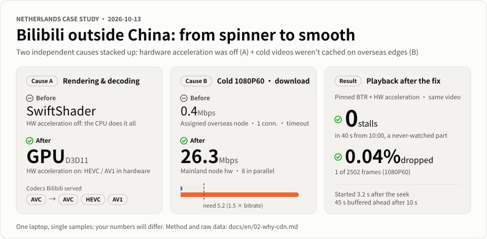
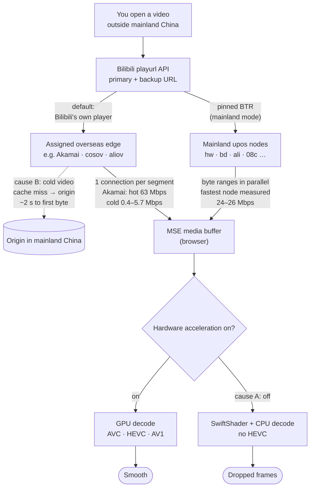
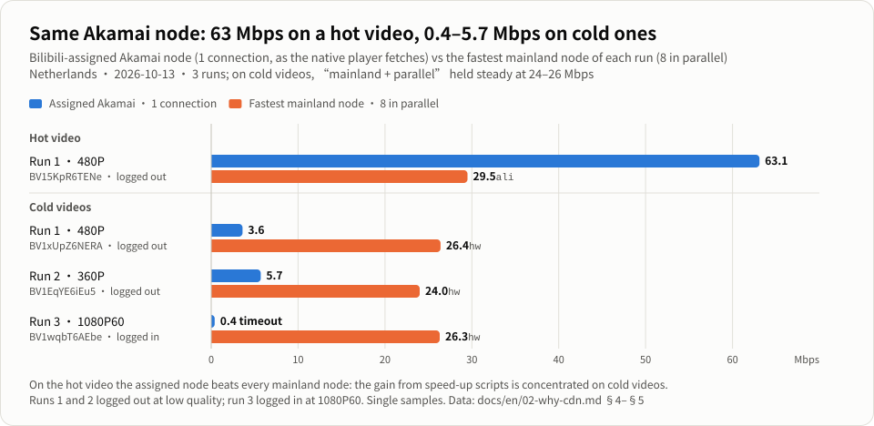
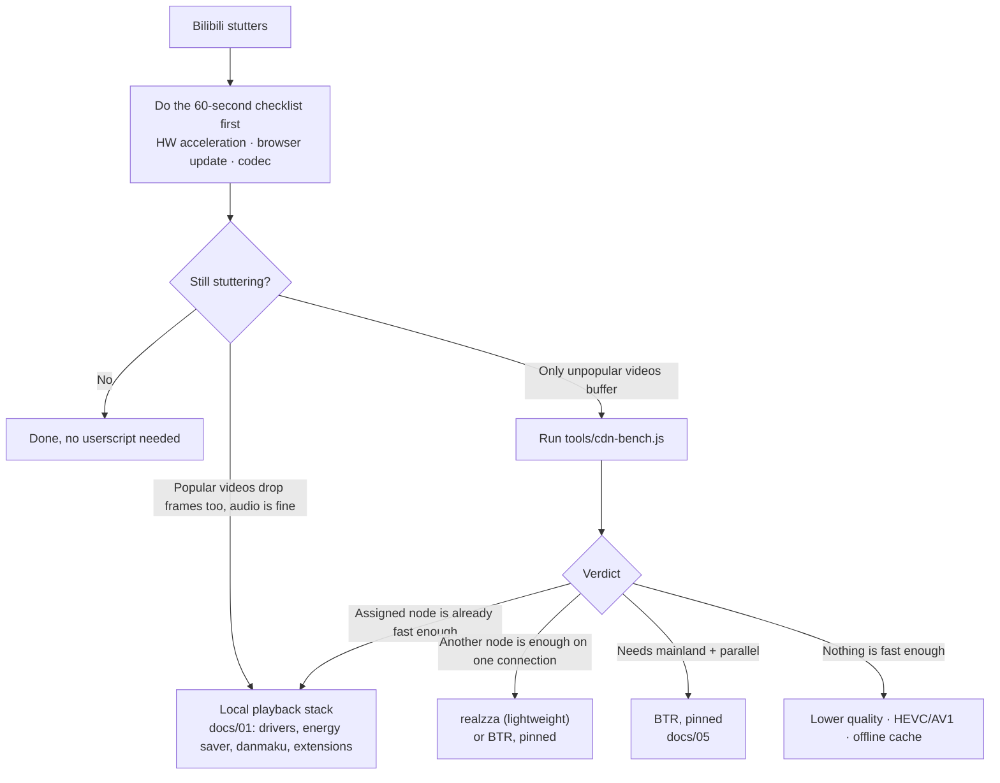

# Bilibili Lagging or Buffering Outside China? Causes, Benchmarks and Safe Fixes

[简体中文](README.md) · **English**

Bilibili (哔哩哔哩 / B站) lag overseas · endless buffering · 1080P60 dropped frames · slow unpopular videos · Chrome / Edge

**Who this is for**: anyone outside mainland China watching Bilibili in Chrome or Edge whose popular videos start instantly but unpopular ones keep buffering, or whose picture stutters.

| Rendering (cause A) | Cold 1080P60 download (cause B) | Playback after the fix |
|:---:|:---:|:---:|
| **SwiftShader → GPU** | **0.4 → 26.3 Mbps** | **0 stalls · 0.04% dropped** |
| One switch, and HEVC / AV1 are decoded by the GPU | Assigned overseas node, 1 connection → mainland node, 8 in parallel (5.2 needed) | Pinned BTR + HW acceleration: 0 stalls in 40 s, 1 of 2502 frames dropped |

Netherlands case study, 2026-10-13, one laptop, single samples. Data and method: <a href="docs/en/02-why-cdn.md">02 · Why the CDN</a>.

You live in Europe, North America, Oceania or somewhere else outside mainland China. You open Bilibili: popular videos start instantly, but unpopular ones keep buffering, and 1080P60 with danmaku (bullet comments) turned on stutters. Advice online is everywhere: change your DNS, use a "return-to-China" accelerator, edit your hosts file… We worked through the problem from scratch in **the Netherlands**: we inspected the browser's internal state, ran 3 benchmark runs covering 10 CDN nodes and 3 unpopular videos, and audited the most-starred speed-up userscript line by line. The conclusion: stutter usually comes from **two independent causes that add up**, and the first one is often fixed by flipping a single switch.

## TL;DR

| | Cause | How to recognise it | What to do | Cost / risk |
|---|---|---|---|---|
| **A** | **Local playback stack**: hardware acceleration is off in the browser, so the CPU decodes the video and the page is rendered in software | Even popular videos drop frames; audio plays fine while the picture stutters; `chrome://gpu` shows *SwiftShader* or *Software only* | Turn on "Use graphics acceleration when available" and relaunch the browser | Free, zero risk |
| **B** | **Unpopular long-tail videos**: overseas CDN edge nodes have nothing cached, so every segment is fetched from the origin servers in mainland China | Only unpopular videos buffer, popular ones are fine; in [`cdn-bench.js`](tools/cdn-bench.js) the assigned node's speed is far below the bitrate | Use a speed-up userscript that spreads requests over several nodes and connections (**BTR, pinned to one version**, or the lighter **realzza**) | Third-party scripts carry supply-chain risk; you must pin the version |

> [!NOTE]
> **Netherlands case study (2026-10-13)**
> - **A**: hardware acceleration was turned off in the browser. The WebGL renderer reported *SwiftShader*, HEVC was unavailable, and 1080P60 was served only as AVC, decoded on the CPU.
> - **B**: on an unpopular video (1080P60 AVC, bitrate 3.48 Mbps), the overseas node Bilibili assigned delivered only **0.4 Mbps** on a single connection; switching to mainland nodes with 8 parallel connections reached **26 Mbps**, about 5 times the speed needed.
>
> Both causes were present at the same time; fixing only one of them is not enough. Data and method: [02 · Why the CDN](docs/en/02-why-cdn.md).

## Where the video gets stuck, in one picture

Popular videos hit the cache on the overseas edge, so they start instantly. For unpopular videos every segment has to come from the origin in mainland China, and the native player opens only 1 connection per segment and does not switch nodes just because one is slow. On popular videos the node Bilibili assigns is faster than any mainland node, so **the gain from speed-up scripts is concentrated on unpopular videos**. How it works, and all the data: [02 · Why the CDN](docs/en/02-why-cdn.md).

## 60-second checklist

Work through it in order. Steps 1–4 use settings built into the browser and the player; nothing needs to be installed.

- [ ] **1. Turn on hardware acceleration** (the most overlooked step)
  Chrome: open `chrome://settings/system`, switch on "Use graphics acceleration when available", then click "Relaunch". Edge: `edge://settings/system`.
  Check: in `chrome://gpu`, *Video Decode* should say *Hardware accelerated*, and the WebGL renderer should not mention *SwiftShader*. Or run the read-only [`tools/decode-check.js`](tools/decode-check.js), which prints a verdict for you. → [Details](docs/en/01-diagnosis.md#2-step-one-is-hardware-acceleration-on)
- [ ] **2. Keep the browser up to date**
  Open `chrome://settings/help` (Edge: `edge://settings/help`). If it shows an error, or the version number never changes, automatic updates may have silently stopped working. Download the official installer from [google.com/chrome](https://www.google.com/chrome/) and run it over the existing install; your bookmarks, extensions and sign-ins are kept. → [Details](docs/en/01-diagnosis.md#3-browser-version-auto-update-can-fail-silently)
- [ ] **3. Pick the right codec (Codec preference)**
  Player ⚙ → "More playback settings (更多播放设置)" → "Codec preference (播放策略)":
  - Hardware decoding works: choose **HEVC**. If `chrome://gpu` lists *Decode av1 profile main*, **AV1** is also fine.
  - Hardware decoding is unavailable: go back to step 1 first. Only if you really cannot fix it, choose **AVC**. At the same quality, AVC needs about 2.3–2.7 times the bitrate of HEVC, so it puts more load on your network.

  → [Details](docs/en/01-diagnosis.md#4-codecs-which-playback-setting-to-choose)
- [ ] **4. Turn off VPN, WARP and proxies while testing**
  They do not change which CDN nodes Bilibili assigns you, and leaving them on makes test results impossible to interpret.
- [ ] **5. Use one userscript manager and one speed-up script only**
  Several speed-up scripts rewrite the same video requests at the same time, fight each other, and when something breaks you cannot tell which one caused it.

**Still stuttering, and only unpopular videos buffer?** That is cause B. Run [`tools/cdn-bench.js`](tools/cdn-bench.js) to benchmark the CDN nodes, then use its "verdict" line to decide whether you need a speed-up userscript; see [02](docs/en/02-why-cdn.md) for details.

## Is BTR safe?

> [!IMPORTANT]
> **BTR** ([Bilibili Thread Ripper / Bilibili 线程撕裂者](https://github.com/MrTangLuyao/Bilibili-thread-ripper), by MrTangLuyao, MIT licence) is currently the most targeted fix for cause B: it downloads from several mainland nodes in parallel.
>
> We statically audited its commit [`0302b34`](https://github.com/MrTangLuyao/Bilibili-thread-ripper/commit/0302b345cdfe367ac599b52dc6874e3f7967e220) (v2026.10.8.1) and **found no malicious behaviour**:
> - the released file can be rebuilt byte for byte from the source;
> - it does not read cookies, has no telemetry and does not contact third-party servers;
> - it does not load remote code.
>
> Apart from the auto-update risk described below, the findings are all low severity, for example a retry loop that sends cookies.
>
> **The main risk lies in the future**: installed the default way, the script silently auto-updates every day from a `main` branch that has no branch protection. So follow [05 · Safe install](docs/en/05-safe-install.md): **pin the version, turn off auto-update, and exclude the login and payment subdomains**.
>
> This audit was carried out with the help of AI code-review tools and covers this one commit only. **It is not an endorsement and gives no guarantee for future versions.** See [03 · BTR security audit](docs/en/03-btr-security-audit.md).

## Decision flow

## Docs

| Doc | Contents |
|---|---|
| [01 · Diagnosis](docs/en/01-diagnosis.md) | Telling buffering from decoding; how to check and fix hardware acceleration, browser updates and codec choice; a three-minute diagnosis routine |
| [02 · Why the CDN](docs/en/02-why-cdn.md) | How cold caches on overseas edge nodes work; full data from the 3 benchmark runs of the Netherlands case study (including a logged-in 1080P60 run); how to measure it yourself |
| [03 · BTR security audit](docs/en/03-btr-security-audit.md) | Audit method, conclusions and every finding; the real risk (unpinned auto-update); the retry-loop bug; cautions about the desktop version and the old extension |
| [04 · Alternatives](docs/en/04-alternatives.md) | Comparison of userscripts, extensions, clients, downloaders and network-level options (with fact-check corrections applied); a "not recommended" list with reasons |
| [05 · Safe install of BTR](docs/en/05-safe-install.md) | Pinned install in Tampermonkey or Violentmonkey; turning off updates, excluding sensitive subdomains, checking permissions; reviewing upgrades; A/B testing and pass criteria; uninstalling |
| [06 · Technical deep dive](docs/en/06-technical-deep-dive.md) | Under the hood: playurl and signed URLs (why mirrors accept a swapped host and Akamai does not); cache tiers and cold misses; TCP arithmetic at 250 ms; how BTR schedules and hedges, compared with realzza and MBGTEB; Chrome's decoder choice and what `mediaCapabilities` really reports; pitfalls of `cdn-bench.js` |

## Tools (read-only: they change no page settings and upload no data)

| Tool | Purpose | Network |
|---|---|---|
| [`tools/decode-check.js`](tools/decode-check.js) | Checks hardware acceleration: the WebGL renderer (flags SwiftShader), AVC / HEVC / AV1 decoding capability at 1080p60 and 4K, Bilibili's codec preference setting, then prints a verdict | Sends no requests at all |
| [`tools/cdn-bench.js`](tools/cdn-bench.js) | For the current video, measures each CDN node's cold-data throughput and time to first byte, compares single and parallel connections, then prints a verdict | Bilibili video CDN only, no cookies |
| [`tools/play-monitor.js`](tools/play-monitor.js) | Records startup time, stall count and duration, waits after seeking, and dropped frames | Sends no requests at all |
| [`tools/verify-tm-install.py`](tools/verify-tm-install.py) | Runs on your computer (Python 3.8+, standard library only): checks that the BTR Tampermonkey **actually stored** is byte-identical to audited commit `0302b34`, that the header was edited as in [05](docs/en/05-safe-install.md), and that "Check for updates" is off, then prints PASS / FAIL; it prints information about the BTR script only | No network, writes no files |

Usage and safety notes: [`tools/README.en.md`](tools/README.en.md). **Read the code from top to bottom before pasting it into the console.** Never paste console code a stranger sends you.

## Not recommended

"Return-to-China" accelerators (回国加速器) and gaming accelerators; pinning IPs in the hosts file and DNS tricks; watching Bilibili with WARP on; the BTR desktop version; the old BTR extension zip from Releases; running two speed-up scripts at once; Windows TCP "optimisers". Reasons and sources: [04 · Alternatives §F](docs/en/04-alternatives.md#f-not-recommended-and-why).

## Contributing

Benchmark results from your region are very welcome, for example North America, Oceania, Southeast Asia or another European country. Please include:

- country or region;
- date and time of day;
- whether you were logged in, the quality and the codec;
- the `cdn-bench.js` table.

**Before submitting, remove** full `.m4s` URLs (they contain your UID and IP address), IP addresses, precise locations and account details. If you spot a mistake in the docs, please open an issue.

## Disclaimer

- This project has no affiliation with Bilibili (哔哩哔哩), nor with the third-party projects or authors mentioned here. Names and trademarks belong to their respective owners.
- Nothing here **bypasses** paywalls, premium membership (大会员), DRM, region locks or login. It only addresses playback smoothness for content you can already watch. Personal use only.
- Speed-up scripts that rewrite CDN addresses may not comply with Bilibili's user agreement and may stop working at any time. Whether to use them is your own decision and your own risk (see [04 §E](docs/en/04-alternatives.md#e-legal-and-longevity-risks)).
- The BTR audit covers **only** commit `0302b345cdfe367ac599b52dc6874e3f7967e220`. It is a static audit, not an endorsement, and does not guarantee that this version or any later version is completely safe.
- The tools in `tools/` are all read-only and neither minified nor obfuscated: the three console snippets are short, and `verify-tm-install.py` uses only the Python standard library and no network. Read the code before running it.
- Benchmarks are single samples; CDN conditions vary with the time of day, the date and the region.

## Credits

Thanks to the authors of [BTR](https://github.com/MrTangLuyao/Bilibili-thread-ripper) (MrTangLuyao), [realzza/bilibili-accelerator](https://github.com/realzza/bilibili-accelerator), [Make Bilibili Great Than Ever Before](https://github.com/SukkaW/Make-Bilibili-Great-Than-Ever-Before) (SukkaW), [StaZhu/enable-chromium-hevc-hardware-decoding](https://github.com/StaZhu/enable-chromium-hevc-hardware-decoding), [BiliLoader](https://github.com/Phantivia/BiliLoader), [chrisliu298/bilibili-cdn-fix](https://github.com/chrisliu298/bilibili-cdn-fix) and other open-source projects for publishing their code and data. Much of the analysis here builds on their work.

## License

- Code in `tools/`: [MIT](LICENSE)
- Docs (`README*`, `docs/`): [CC BY 4.0](https://creativecommons.org/licenses/by/4.0/); please credit the source when you reuse them

**Last verified: 2026-10-13** · [Changelog](CHANGELOG.md)
