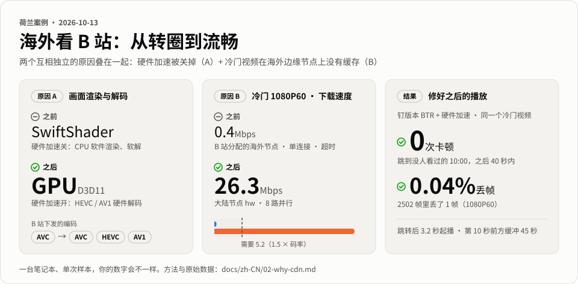
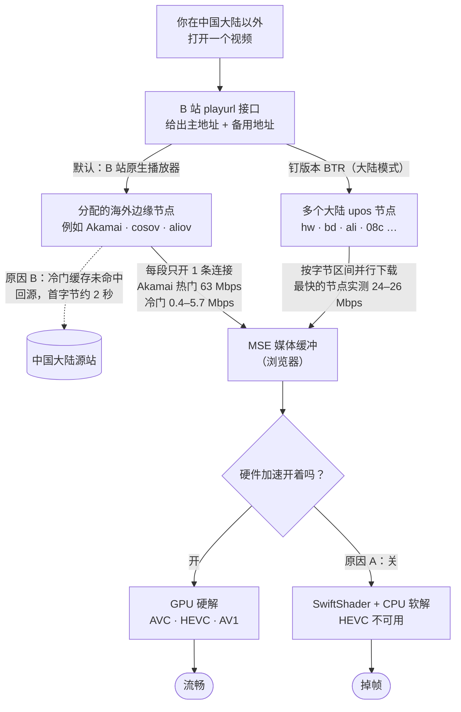
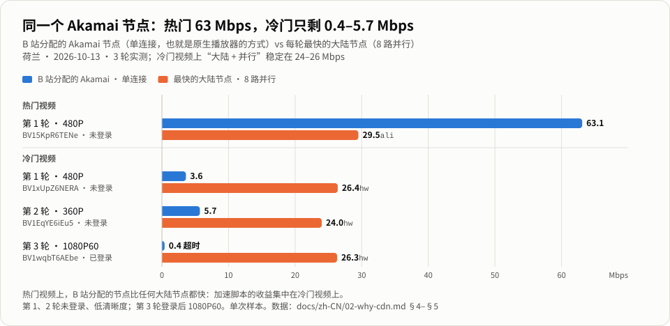
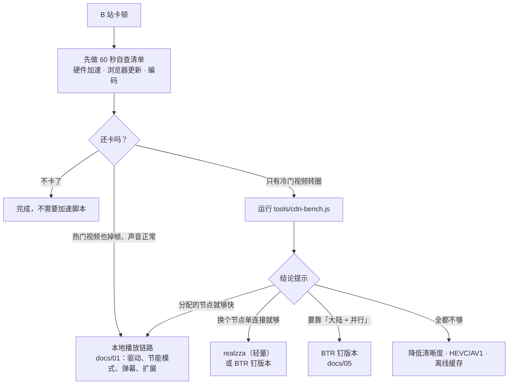

# 海外看 B 站卡顿、转圈？ 原因、实测与安全加速方案

**简体中文** · [English](README.en.md)

哔哩哔哩 / bilibili 海外卡顿 · 缓冲转圈 · 1080P60 掉帧 · 冷门视频加载慢 · Chrome / Edge

**适合谁**：人在中国大陆以外、用 Chrome / Edge 看 B 站，热门视频秒开，冷门视频却一直转圈，或者画面一顿一顿。

| 画面渲染（原因 A） | 冷门 1080P60 下载（原因 B） | 修好之后的播放 |
|:---:|:---:|:---:|
| **SwiftShader → GPU** | **0.4 → 26.3 Mbps** | **0 次卡顿 · 丢帧 0.04%** |
| 打开一个开关， HEVC / AV1 改由显卡硬解 | B 站分配的海外节点单连接 → 大陆节点 8 路并行（需要 5.2） | 钉版本 BTR + 硬件加速： 40 秒内 0 次卡顿，2502 帧丢 1 帧 |

荷兰案例，2026-10-13，一台笔记本、单次样本。数据和方法见 <a href="docs/zh-CN/02-why-cdn.md">02 · 原因与实测</a>。

人在欧洲、北美、澳洲或其它海外地区，打开 B 站，热门视频秒开，冷门视频却一直转圈，1080P60 一开弹幕就一顿一顿。网上的建议很多：换 DNS、开回国加速器、改 hosts……我们在**荷兰**把这个问题从头查了一遍，看了浏览器内部状态，做了 3 轮实测、覆盖 10 个 CDN 节点和 3 个冷门视频，还逐行审计了星标最多的加速脚本。结论是：卡顿通常来自**两个互相独立、会叠加的原因**，而第一个往往只要打开一个开关。

## TL;DR

| | 原因 | 怎么认出来 | 怎么办 | 成本 / 风险 |
|---|---|---|---|---|
| **A** | **本地播放链路**：浏览器的硬件加速被关掉，视频由 CPU 软解、画面由软件渲染 | 热门视频也掉帧；声音正常、画面一顿一顿；`chrome://gpu` 里出现 *SwiftShader* 或 *Software only* | 打开「使用图形加速功能」并重启浏览器 | 免费，零风险 |
| **B** | **冷门长尾视频**：海外 CDN 边缘节点没有缓存，每段数据都要回中国大陆的源站取 | 只有冷门视频转圈，热门正常；[`cdn-bench.js`](tools/cdn-bench.js) 里分配节点的速度远低于码率 | 换用多节点、多连接的加速脚本（**BTR 钉版本**，或更轻量的 **realzza**） | 第三方脚本有供应链风险，必须钉版本 |

> [!NOTE]
> **荷兰案例（2026-10-13）**
> - **A**：浏览器的硬件加速是关着的。WebGL 渲染器显示为 *SwiftShader*，HEVC 不可用，1080P60 只能拿到 AVC，而且是 CPU 软解。
> - **B**：一个冷门视频（1080P60 AVC，码率 3.48 Mbps），B 站分配的海外节点单连接只跑出 **0.4 Mbps**；换成大陆节点、8 路并行，能到 **26 Mbps**，约为所需速度的 5 倍。
>
> 两个原因同时存在，只修其中一个是不够的。数据和方法见 [02 · 原因与实测](docs/zh-CN/02-why-cdn.md)。

## 一张图看懂：视频卡在哪一段

热门视频命中海外边缘的缓存，所以秒开；冷门视频每段都要回大陆源站取，而原生播放器每段只开 1 条连接，也不会因为慢就换节点。热门视频上，B 站分配的节点比任何大陆节点都快，所以**加速脚本的收益集中在冷门视频上**。原理和全部数据见 [02 · 原因与实测](docs/zh-CN/02-why-cdn.md)。

## 60 秒自查清单

按顺序做。前 4 步都是浏览器和播放器自带的设置，不用安装任何东西。

- [ ] **1. 打开硬件加速**（最容易被忽略）
  Chrome：地址栏打开 `chrome://settings/system`，打开「使用图形加速功能（如果可用）」，再点「重新启动」。Edge：`edge://settings/system`。
  验证：`chrome://gpu` 里 *Video Decode* 应显示 *Hardware accelerated*，WebGL 渲染器里不应出现 *SwiftShader*。也可以运行只读的 [`tools/decode-check.js`](tools/decode-check.js)，它会直接给出结论。→ [详解](docs/zh-CN/01-diagnosis.md#2-第一步硬件加速开了吗)
- [ ] **2. 浏览器保持最新**
  打开 `chrome://settings/help`（Edge 为 `edge://settings/help`）。如果这里报错，或者版本号一直不变，自动更新可能已经悄悄失效了。这时从 [google.com/chrome](https://www.google.com/chrome/) 下载官方安装包覆盖安装即可，书签、扩展和登录状态都会保留。→ [详解](docs/zh-CN/01-diagnosis.md#3-浏览器版本自动更新可能静默失效)
- [ ] **3. 选对编码（播放策略）**
  播放器 ⚙ →「更多播放设置」→「播放策略」：
  - 硬解正常：选 **HEVC**。如果 `chrome://gpu` 里列出了 *Decode av1 profile main*，也可以选 **AV1**。
  - 硬解不可用：先回到第 1 步。实在修不好，再选 **AVC**。同画质下 AVC 的码率约是 HEVC 的 2.3–2.7 倍，对网络的要求也更高。

  → [详解](docs/zh-CN/01-diagnosis.md#4-编码播放策略怎么选)
- [ ] **4. 测试时关掉 VPN、WARP 和代理**
  它们不会改变 B 站分配给你的 CDN 节点，开着反而让测试结果没法解释。
- [ ] **5. 只用一个脚本管理器、一个加速脚本**
  几个加速脚本会同时改写同一批视频请求，互相打架，出了问题也查不出是谁。

**做完还卡，而且只有冷门视频转圈？** 那就是原因 B。先运行 [`tools/cdn-bench.js`](tools/cdn-bench.js) 测速，再按它给出的「结论提示」决定要不要装加速脚本，详见 [02](docs/zh-CN/02-why-cdn.md)。

## BTR 安全吗？

> [!IMPORTANT]
> **BTR**（[Bilibili 线程撕裂者](https://github.com/MrTangLuyao/Bilibili-thread-ripper)，作者 MrTangLuyao，MIT 许可）是目前对原因 B 最对症的方案：同时从多个大陆节点并行下载。
>
> 我们对它的提交 [`0302b34`](https://github.com/MrTangLuyao/Bilibili-thread-ripper/commit/0302b345cdfe367ac599b52dc6874e3f7967e220)（v2026.10.8.1）做了静态审计，**没有发现恶意行为**：
> - 发布文件可以由源码逐字节重建；
> - 不读取 Cookie，没有遥测，不连第三方服务器；
> - 不加载远程代码。
>
> 除下面说的自动更新风险外，其余发现都是低危，比如一个带 Cookie 的重试循环。
>
> **主要风险在以后**：按默认方式安装，脚本每天会从一个没有分支保护的 `main` 分支静默自动更新。所以请按 [05 · 安全安装](docs/zh-CN/05-safe-install.md) 操作：**钉死版本、关闭自动更新、排除登录和支付子域**。
>
> 这次审计借助 AI 代码审查工具完成，只覆盖这一个提交，**不构成背书，也不保证以后的版本**。详见 [03 · BTR 安全审计](docs/zh-CN/03-btr-security-audit.md)。

## 决策流程

## 文档

| 文档 | 内容 |
|---|---|
| [01 · 诊断](docs/zh-CN/01-diagnosis.md) | 怎么区分缓冲和解码；硬件加速、浏览器更新、编码怎么查、怎么修；三分钟诊断流程 |
| [02 · 原因与实测](docs/zh-CN/02-why-cdn.md) | 海外边缘冷缓存的原理；荷兰案例 3 轮测速的完整数据（含登录后 1080P60）；怎么自己测 |
| [03 · BTR 安全审计](docs/zh-CN/03-btr-security-audit.md) | 审计方法、结论和全部发现；真正的风险（未钉版本的自动更新）；重试循环 bug；桌面版和旧插件的注意事项 |
| [04 · 替代方案](docs/zh-CN/04-alternatives.md) | 脚本、扩展、客户端、下载器、网络层方案的对比（已按事实核查更正）；不推荐清单及原因 |
| [05 · 安全安装 BTR](docs/zh-CN/05-safe-install.md) | 在 Tampermonkey 或 Violentmonkey 里钉版本安装；关闭更新、排除敏感子域、核对权限；升级复审；A/B 测试与通过标准；卸载 |
| [06 · 技术深挖](docs/zh-CN/06-technical-deep-dive.md) | 拆开讲原理：playurl 与签名地址（为什么换主机名后镜像认、Akamai 不认）；缓存分层与冷缓存未命中；250 ms 往返下的 TCP 算术；BTR 怎么调度和对冲，与 realzza、MBGTEB 对比；Chrome 怎么选解码器、`mediaCapabilities` 到底报告什么；`cdn-bench.js` 的陷阱 |

## 工具（只读，不改页面设置，不上传任何数据）

| 工具 | 用途 | 网络 |
|---|---|---|
| [`tools/decode-check.js`](tools/decode-check.js) | 检查硬件加速：WebGL 渲染器（标出 SwiftShader），AVC / HEVC / AV1 在 1080p60 和 4K 下的解码能力，B 站播放策略，最后给出结论 | 不发任何请求 |
| [`tools/cdn-bench.js`](tools/cdn-bench.js) | 对当前视频测各 CDN 节点的冷数据吞吐和首字节时间，比较单连接与并行，最后给出结论提示 | 只连 B 站视频 CDN，不带 Cookie |
| [`tools/play-monitor.js`](tools/play-monitor.js) | 记录首帧时间、卡顿次数和时长、拖动后的等待、丢帧 | 不发任何请求 |
| [`tools/verify-tm-install.py`](tools/verify-tm-install.py) | 在本机运行（Python 3.8+，只用标准库）：核对 Tampermonkey **实际存下来**的 BTR 是否与审计提交 `0302b34` 逐字节一致、文件头是否按 [05](docs/zh-CN/05-safe-install.md) 改好、「检查更新」是否已关闭，最后给出 PASS / FAIL；只输出 BTR 这一个脚本的信息 | 不联网，不写任何文件 |

使用方法和安全须知见 [`tools/README.md`](tools/README.md)。**往控制台粘贴代码之前，请先从头到尾读一遍。** 陌生人发来的控制台代码一律不要粘贴。

## 不推荐的做法

回国加速器、游戏加速器；改 hosts 钉 IP、DNS 技巧；开着 WARP 看 B 站；BTR 桌面版；Releases 里的旧版 BTR 插件 zip；同时开两个加速脚本；Windows TCP「优化器」。原因和来源见 [04 · 替代方案 §F](docs/zh-CN/04-alternatives.md#f-不推荐清单及原因)。

## 参与贡献

欢迎提交你所在地区的测速结果，比如北美、澳洲、东南亚，或者别的欧洲国家。请附上：

- 国家或地区；
- 日期和时段；
- 是否登录、清晰度和编码；
- `cdn-bench.js` 的表格。

**提交前请删掉** 完整的 `.m4s` 地址（里面有你的 UID 和 IP）、IP、精确位置和账号信息。发现文档有错误，也欢迎提 issue 更正。

## 免责声明

- 本项目与哔哩哔哩（bilibili）没有任何关联，与文中提到的第三方项目及其作者也没有关联。文中提到的名称和商标归各自所有者所有。
- 这里的内容**不绕过**付费、大会员、DRM、地区限制或登录，只针对你本来就能观看的内容，解决播放流畅度问题。仅供个人使用。
- 改写 CDN 地址的加速脚本可能不符合 B 站用户协议，也随时可能失效。是否使用，请自行判断并承担风险（见 [04 §E](docs/zh-CN/04-alternatives.md#e-法律与存续风险)）。
- BTR 审计**只覆盖**提交 `0302b345cdfe367ac599b52dc6874e3f7967e220`，是一次静态审计，不是背书，也不担保这一版或以后的版本绝对安全。
- `tools/` 里的工具都是只读的，没有压缩或混淆：三个控制台片段都很短，`verify-tm-install.py` 只用 Python 标准库、不联网。请先读代码再运行。
- 测速只是单次样本，CDN 状况会随时段、日期和地区变化。

## 致谢

感谢 [BTR](https://github.com/MrTangLuyao/Bilibili-thread-ripper)（MrTangLuyao）、[realzza/bilibili-accelerator](https://github.com/realzza/bilibili-accelerator)、[Make Bilibili Great Than Ever Before](https://github.com/SukkaW/Make-Bilibili-Great-Than-Ever-Before)（SukkaW）、[StaZhu/enable-chromium-hevc-hardware-decoding](https://github.com/StaZhu/enable-chromium-hevc-hardware-decoding)、[BiliLoader](https://github.com/Phantivia/BiliLoader) 和 [chrisliu298/bilibili-cdn-fix](https://github.com/chrisliu298/bilibili-cdn-fix) 等开源项目的作者公开代码和数据。本文的很多分析都建立在他们的工作之上。

## 许可

- `tools/` 中的代码：[MIT](LICENSE)
- 文档（`README*`、`docs/`）：[CC BY 4.0](https://creativecommons.org/licenses/by/4.0/deed.zh-hans)，转载请注明出处

**最后核实：2026-10-13** · [更新记录](CHANGELOG.md)
