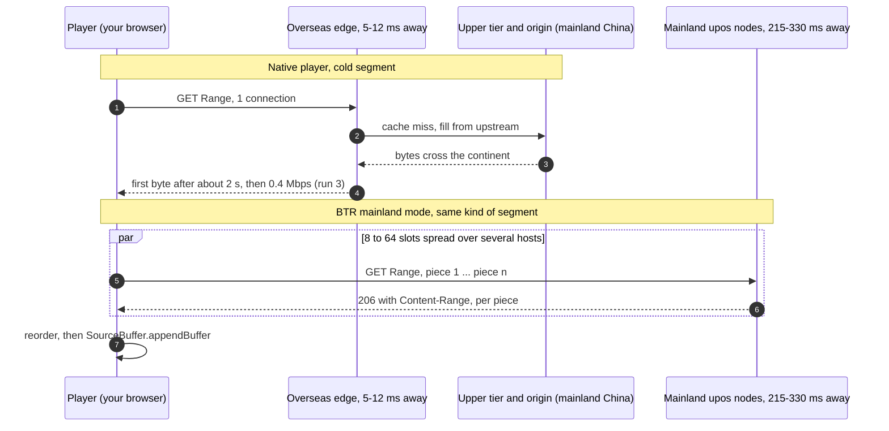
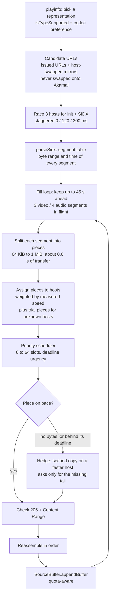

# 06 · Technical deep dive: from playurl to pixels

[简体中文](../zh-CN/06-technical-deep-dive.md) · **English** · [← Back to README](../../README.en.md)

> **In one line**: a Bilibili video outside China has to clear two independent hurdles. Cold bytes have to be fetched from mainland China and then reach you over one long-distance connection per segment (the network half), and every frame must be decoded and composited within 16.7 ms at 60 fps (the local half). This page takes both apart: signed URLs, cache tiers, TCP arithmetic, BTR's scheduler and Chrome's media stack, with sources throughout and inferences marked.

> [!NOTE]
> **How to read this page.** Statements about code link to a pinned commit (BTR [`0302b34`][btr-c], realzza [v0.5.0][rz-tag], MBGTEB [1.9.0][mbg-tag]); Chromium links point to `main` and name the identifiers to search for. Measurements come from the Netherlands case study in [02](02-why-cdn.md). Anything we infer rather than observe is marked **(inference)**. Bilibili has not published how its URL signatures or CDN contracts work, so those parts describe observed behaviour as of October 2026, and it can change at any time.

**At a glance**

- A signed media URL can be moved to another `*.bilivideo.com` host and still works; moved onto Akamai, it gets 403. Everything that "switches CDN" depends on that difference.
- On the three cold videos, the assigned Akamai node needed **1792–2119 ms** before the first byte; on the hot video it answered in **69 ms**.
- Textbook TCP at 250 ms round-trip time and 0.1% packet loss tops out around **1.8 Mbps per connection**. On a cold video, the long-haul fetch plus one connection per segment is the bottleneck, not your broadband.
- BTR = SIDX index → byte-range planning → priority scheduler → hedged duplicate requests → Media Source Extensions.
- With hardware acceleration off, Chrome itself had recorded 1080p60 AVC as "not smooth": the browser had already measured the stutter.

**Contents**

1. [How Bilibili delivers a web video](#1-how-bilibili-delivers-a-web-video)
2. [Cache tiers: why cold long-tail videos stall overseas](#2-cache-tiers-why-cold-long-tail-videos-stall-overseas)
3. [Why one long-distance connection is slow](#3-why-one-long-distance-connection-is-slow)
4. [How BTR works, end to end](#4-how-btr-works-end-to-end)
5. [The playback stack on your computer](#5-the-playback-stack-on-your-computer)
6. [How cdn-bench.js measures, and how it can mislead](#6-how-cdn-benchjs-measures-and-how-it-can-mislead)
7. [Limits and caveats](#7-limits-and-caveats)
8. [Sources](#sources)

## 1. How Bilibili delivers a web video

### 1.1 playurl: the menu of streams

When a video page loads, the player asks `api.bilibili.com/x/player/wbi/playurl` for the streams (the request is WBI-signed; the older unsigned `/x/player/playurl` still answers, and BTR uses it with `fnval=4048`, "all DASH streams" ([page-hook L733][btr-playurl], [API docs][api-ep])). The first answer is usually embedded in the page as `window.__playinfo__`. With DASH requested, it contains `dash.video[]` and `dash.audio[]`, one entry per quality × codec ([API docs][api-dash]):

| Field | Meaning |
|---|---|
| `id` | Quality code (qn): 16 = 360P, 32 = 480P, 64 = 720P, 80 = 1080P, 112 = 1080P+, 116 = 1080P60, 120 = 4K |
| `codecid` | 7 = AVC (H.264), 12 = HEVC (H.265), 13 = AV1 |
| `codecs` | RFC 6381 codec string such as `avc1.640032`; the player checks it with `MediaSource.isTypeSupported()` |
| `bandwidth` | Declared bitrate. MPEG-DASH defines it in bits per second (the community docs label it bytes, but the values and `cdn-bench.js`'s arithmetic match bits) |
| `baseUrl`, `backupUrl[]` | The same file on a primary host and on backup hosts, each URL signed |
| `segment_base.initialization` | Byte range of the init segment (`ftyp` + `moov` boxes) |
| `segment_base.index_range` | Byte range of the `sidx` box, the index of every media segment |

Each quality × codec is **one fragmented-MP4 file** (`.m4s`) for the whole video, addressed with HTTP Range requests ([RFC 9110 §14][rfc9110-range]), not thousands of small files. The video in run 3 (1080P60 AVC, declared 3.48 Mbps) was a single file of about 1494 MB ([02 §2](02-why-cdn.md#2-netherlands-case-study-test-setup)).

### 1.2 What Bilibili's own player does with it

realzza read the player's source and checked it in Chromium ([vod-routing.md][rz-player]); BTR's README says the same about connections ([README L112][btr-readme-1conn]):

- The player is a **dash.js fork**. Each representation gets `urls = [baseUrl, ...backupUrl]` and a **sticky index** into that list.
- It moves to the next URL only on **an error, no first byte within about 2 s, or the total timeout**; up to 3 retries per fragment.
- **One `XMLHttpRequest` per fragment**, one connection, and it buffers 70–80 s ahead.

A host that answers and then trickles trips none of these rules. In run 3 the assigned Akamai node delivered **0.4 Mbps** against a declared **3.48 Mbps**, and the player had no rule that said "too slow, go elsewhere".

### 1.3 Anatomy of a signed media URL

A schematic (placeholders only; parameter sets and order vary between URLs and over time):

```
https://upos-sz-mirrorXXX.bilivideo.com/upgcxcode/<aa>/<bb>/<id>/<id>-1-<stream>.m4s
  ?e=<opaque>&uipk=<n>&nbs=1&deadline=<unix time>&gen=playurlv3
  &os=<pool>&og=<group>&oi=<your IP as an integer>&mid=<your UID>&platform=pc&trid=<trace id>
  &upsig=<32 hex digits>&uparams=e,uipk,nbs,deadline,gen,os,og,oi,mid,platform,trid
  &bvc=vod&nettype=0&orderid=0,3&bw=<bitrate>&...
```

| Parameter | What it is | Source |
|---|---|---|
| `deadline` | Expiry as a Unix timestamp. The community docs say URLs are valid for 120 min; `cdn-bench.js` refuses to run on expired ones | [API docs][api-120], [cdn-bench L127-128][cb-deadline] |
| `os` | The pool the URL was issued for: e.g. `cosovbv` (the overseas Tencent edge), `akam` (Akamai), `mcdn` (P2P / MCDN nodes) | [realzza][rz-hosts], [API docs example][api-dash] |
| `og` | Appears in newer URLs (values such as `hw`, `cos`); undocumented, possibly the origin or storage group **(inference)** | [API docs example][api-dash] |
| `oi`, `mid` | Your IP address as a 32-bit integer, and your UID (0 when logged out). **This is why you must never post a full `.m4s` URL** | [02 §8](02-why-cdn.md#8-test-it-yourself) |
| `platform=pc` | Web streams check the `Referer` (must be under `.bilibili.com`) and a non-empty User-Agent, otherwise 403 | [API docs][api-referer], [realzza][rz-hosts] |
| `upsig` | The signature (32 hex digits). Algorithm and key are not public | — |
| `uparams` | The list of parameters `upsig` covers. **The host name is not in it** | [API docs example][api-dash] |
| `hdnts` (Akamai URLs only) | An Akamai EdgeAuth token: validity window and path or ACL, plus an HMAC checked by Akamai's edge with a key configured for the customer's property | [realzza][rz-hosts], [Akamai EdgeAuth][akamai-edgeauth] |

### 1.4 Why mirrors accept a swapped host and Akamai does not

**What we and others observed**

- In run 3, a non-Akamai URL with only the host name changed was served by all 8 hosts we swapped it onto (aliov, Hong Kong, ali, hw, 08c, cos, bd, estgoss), at very different speeds ([02 §3](02-why-cdn.md#3-run-3-logged-in-1080p60-closest-to-everyday-viewing)). `cdn-bench.js` never swaps onto Akamai ([L134-148][cb-nodes]).
- realzza, from the US West Coast: the `os=cosovbv` URL "is accepted by every UPOS mirror in the pool"; the Akamai URL carries `os=akam` plus an `hdnts` token, and a host swap onto Akamai "is refused with 403" ([vod-routing.md L115][rz-hosts]). PiliPlus users report the same 403 when the starting URL is Akamai's ([#3242][pili3242]).
- BTR refuses to put another node's URL onto `*.akamaized.net` ([`swapOrdinaryHost`, L44-57][btr-swap]). Its source also says that when an account is issued only Akamai URLs, `*.bilivideo.com` nodes "accept those signatures too", so in that one case BTR swaps the Akamai URL onto them ([L74-85][btr-donor]).
- MBGTEB's source agrees on one direction and is more cautious on the other: upos signatures on Akamai "refuse with 403 (verified)", Akamai signatures elsewhere are "unverified" and tried last ([candidates.ts L42-46][mbg-cand]).

**The likely explanation (inference)**

- `upsig` signs the parameters listed in `uparams` and not the host, and every node behind a `*.bilivideo.com` name evidently verifies it the same way. So one signed URL works on any of them. Interestingly, `os` is in the signed list and still says `cosovbv` when `mirrorhw` serves the request, so nodes apparently do not check `os` against their own identity.
- Akamai is a third-party CDN that enforces its own token. A URL minted for a `bilivideo` host has no valid `hdnts` for Akamai's edge to check, so Akamai returns 403. The reverse direction reportedly works (BTR's comment says so; MBGTEB calls it unverified), which would mean Akamai-issued URLs also carry the ordinary `upsig` set alongside `hdnts`.
- None of this is documented by Bilibili. CDN-switching tools have broken before when the rules changed ([04 §A, rows 4 and 6](04-alternatives.md#a-in-the-browser-userscripts--extensions)), and rewriting CDN addresses may not comply with Bilibili's user agreement ([04 §E](04-alternatives.md#e-legal-and-longevity-risks)).

## 2. Cache tiers: why cold long-tail videos stall overseas

### 2.1 Three tiers, in Bilibili's own words

- **Bilibili's public-network architecture article** (quoted with a screenshot in [BTR's README, L128-134][btr-readme-arch]; the original page sits behind a captcha for automated readers): **edge nodes** are small and "缓存热门数据" (cache hot data); **regional backbone nodes** absorb edge overflow and failover and act as a second-level cache; the **core IDC** (origin) holds every resource.
- **《B站下行CDN架构的探索与应用》** (Bilibili tech team, 2024-04-23, [link][bili-cdn2024]; only excerpts were available to us): inside an edge cluster, gateway nodes sit in front of an origin-fetch convergence component (回源收敛) that merges misses before they go upstream, and hot content is detected and prefetched.
- **QCon 2023 talk preview by a Bilibili engineer**, about Bilibili's TV app ([InfoQ][infoq-tv]): 4K video "本质上是冷资源" (is essentially cold content); through the normal CDN origin-fetch path its stall rate exceeded 5%, and moving it to central storage plus edge POPs brought it down to about 1.5%. Even inside China, cold content through the miss path stalls.
- **Outside China** the edge is usually a third-party CDN. In the Netherlands: Akamai's local node, cosov via Tencent EdgeOne, aliov on an Alibaba Cloud node in the Netherlands ([02 §6](02-why-cdn.md#6-other-network-observations-same-day-same-computer)). How their parent tiers are set up for Bilibili is not public; Akamai's own [Tiered Distribution][akamai-tiered] places parents "close to the origin".

### 2.2 What one cold miss costs



| | Hot (edge has the bytes) | Cold (edge must fetch them) |
|---|---|---|
| Akamai, single connection | **63.1 Mbps**, TTFB **69 ms** (run 1) | **0.4–5.7 Mbps**, TTFB **1792–2119 ms** (runs 1–3) |
| realzza's measurements (US West) | Warm edge answers in 30–60 ms | 1.4–11.5 s to first byte, then 1–8 Mbps ([L121][rz-time]) |

Why the long tail is always cold: the run-3 video had 65 views and a file of about 1494 MB. The chance that anybody in your region already pulled the bytes at minute 10 into a European edge is essentially zero. A popular video's bytes were pulled by thousands of viewers before you. Same edge, same route, opposite result: **the difference is popularity, not geography**.

### 2.3 Why mainland nodes and parallel requests help

- **Mainland nodes** (inference): they sit next to the regional and core tiers, so a miss there is a short domestic fetch. What is left is the long-RTT path to you, which is a TCP problem (§3) that parallelism can solve.
- **Parallel requests on cold data**: each request in flight triggers its own upstream fill, so 8 concurrent ranges are 8 concurrent fills. On hot data there is nothing to fill and one connection already runs near line rate, which is why parallelism gained almost nothing on the popular video ([02 §5](02-why-cdn.md#5-what-the-three-unpopular-videos-have-in-common)).
- **Parallel on cold Akamai made things worse** (0.5–0.7 Mbps with timeouts). We cannot see inside Akamai; plausible reasons are that concurrent misses on one object are collapsed into a single upstream fill, plus the 6-connection limit for HTTP/1.1 hosts (§3.4) **(inference)**.

## 3. Why one long-distance connection is slow

### 3.1 The Mathis bound, worked at 250 ms

For a loss-based (Reno-style) TCP flow, Mathis et al. ([1997][mathis]) give the steady-state ceiling:

```
throughput ≤ (MSS / RTT) × (C / √p)        C = √(3/2) ≈ 1.22
```

With MSS = 1460 bytes (11,680 bits): at RTT = 250 ms, MSS / RTT = 46.7 kbit/s. Multiply by 1.22 / √p:

| Packet loss p | RTT 5 ms (local edge) | RTT 250 ms (Europe ↔ mainland) |
|---:|---:|---:|
| 1% | 28.6 Mbps | 0.57 Mbps |
| 0.1% | 90 Mbps | 1.8 Mbps |
| 0.01% | 286 Mbps | 5.7 Mbps |
| 0.001% | 905 Mbps | 18.1 Mbps |

Same loss rate, 50 times the round trip, 50 times less throughput. To carry 5.2 Mbps (1.5 × 3.48) on one such flow at 250 ms, loss must stay below about 0.012%, roughly one lost packet in 8,000, on a path that crosses several carriers. Caveats: the sender's congestion control is chosen by the CDN, not by you. CUBIC has a Reno-friendly mode ([RFC 9438 §4.3][rfc9438]) but otherwise regrows its window faster than Reno after a loss; BBR is not loss-based at all. Treat the table as orders of magnitude, not predictions.

### 3.2 Slow start eats short samples

A new connection starts with about 10 segments (14.6 KB, [RFC 6928][rfc6928]) and roughly doubles per round trip. Delivering 2 MB (2 MiB) takes 8 rounds of data, so about 8 round trips. At 250 ms that is about **2–2.25 s on an already-open connection (≤ 7.5–8.4 Mbps)**; a new connection adds about 0.5 s for the TCP and TLS 1.3 handshakes (**2.5–2.75 s, ≤ 6.1–6.7 Mbps**). That holds even with zero loss and an infinitely fast server. Most mainland single-connection results in run 3 (2.3–6.9 Mbps) sit inside that envelope, so they say little about the nodes' real capacity. realzza saw the same: mainland mirrors look like 6–10 Mbps in the first 768 KB and then sustain 38–84 Mbps ([L121][rz-time], [L50-66][rz-probe]). CDNs may use larger initial windows, so this is indicative only.

At full speed the pipe must also hold a lot of data: 26.3 Mbps × 250 ms ≈ 800 KiB in flight. Windows' receive-window auto-tuning normally allows that; do not switch it off ([04 §F](04-alternatives.md#f-not-recommended-and-why)).

### 3.3 Parallel ranges across nodes

- **N independent flows ≈ N × the per-flow bound**, as long as the bottleneck is per-flow (loss × RTT) and not your access link. Long-lived connections pay slow start once.
- **Different hosts mean different server paths and different upstream fills**, which matters most on cold data (§2.3).
- **There is a cost.** HTTP/1.1 asks clients to "be conservative when opening multiple connections", warns of "undesirable side effects in congested networks", and notes servers may reject traffic that looks abusive ([RFC 9112 §9.4][rfc9112]). In BTR's automatic mode the ladder's floor is 8 slots and each playback start opens with at least 16 ([L124-151][btr-ladder]); it steps back on HTTP 412 / 429 ([L320-322][btr-auto-signals], [L632-635][btr-sample]). A fixed manual setting does not step back.

### 3.4 The HTTP/2 catch: multiplexing and connection coalescing

- **Multiplexing**: in a browser, all parallel ranges to **one** HTTP/2 host are streams on **one** TCP connection: one congestion window, and one lost packet stalls every stream (TCP head-of-line blocking). "8-way parallel" to one HTTP/2 host is therefore not 8 TCP flows. On cold data its gain comes from 8 concurrent upstream fills; in `cdn-bench.js` it also benefits from a connection the single test has just warmed up.
- **Coalescing**: HTTP/2 lets a client reuse a connection for another host name if the server is authoritative for it, i.e. the certificate covers it ([RFC 9113 §9.1.1][rfc9113]). Per [Stenberg's write-up][coalesce], Chrome does this when the new name's DNS answer includes the IP of the existing connection. upos hosts present a `*.bilivideo.com` wildcard certificate (observed on the hosts we checked), and hw, 08c, 08h, hwo1 and 08ct resolve to the same addresses ([02 §6](02-why-cdn.md#6-other-network-observations-same-day-same-computer)). So "five nodes" may be one connection on one path.
- **A hypothesis worth checking**: 08c had the best mainland single-connection result in run 3 (18.1 Mbps, TTFB 606 ms). `cdn-bench.js` tests it right after hw, with which it shares IP addresses. If Chrome reused hw's already-warm connection, that number measured a warm connection rather than 08c's own path. Not verified; a `chrome://net-export` log would show it.
- **HTTP/1.1 hosts** (Akamai and estgoss negotiated only HTTP/1.1): Chrome opens at most **6 connections per host** ([Chromium `client_socket_pool_manager.cc`][cr-sockets], `g_max_sockets_per_group`), so 8 parallel requests become 6 plus 2 waiting. MBGTEB caps itself at 6 per host for exactly this reason ([engine.ts L48-52][mbg-caps]).

## 4. How BTR works, end to end

Everything below is BTR at commit [`0302b34`][btr-c] (v2026.10.8.1), the audited version ([03](03-btr-security-audit.md)). Constants can change in any later release.



### 4.1 Takeover and track choice

- **Full takeover** (default, [bridge.js L10][btr-defaults]) creates its own `MediaSource` on the page's `<video>` and adds one video and one audio `SourceBuffer` ([native-mse-player L922-966][btr-ms]). **Compatibility mode** leaves Bilibili's player in charge of decoding, buffering and quality switching, and only downloads its media requests ([native-range-transport L10-13][btr-compat]).
- Track choice keeps only representations that `MediaSource.isTypeSupported()` accepts, puts the codec picked in the player menu first, and otherwise prefers **AV1 > HEVC > AVC** ([L84-109][btr-codec], [L114-147][btr-select]). That is why [05 ⑥](05-safe-install.md#2-install-recipe-tampermonkey-chrome--edge) says to pick the codec explicitly: "playable" is not "hardware-decoded" (§5.2).

### 4.2 Index first: init segment and SIDX

- For each track, the init range and the index range are fetched in parallel ([L520-555][btr-loadtrack]), each racing up to 3 candidate hosts started 0, 120 and 300 ms apart ([idm L883-914][btr-meta]).
- [`parseSidx`][btr-sidx] walks the ISO BMFF `sidx` box: after `first_offset`, each reference gives a referenced size and a duration, so BTR turns it into a table of absolute byte ranges and start times ([L60-89][btr-sidx-ref]). A seek is a binary search in that table ([`segmentIndexAt`, L98-111][btr-seek]). The init segment (`ftyp` + `moov`) is appended first, as the [MSE ISO BMFF byte-stream format][mse-isobmff] requires.

### 4.3 Range planning

- **How far ahead**: the fill loop keeps up to `bufferAheadSeconds = 45` s buffered ([range-core L126][btr-settings], [L636-638][btr-fill]), with a sliding window of 3 video or 4 audio segments in flight. The first segment gets priority 120, later ones 55 − 5 per position (minimum 30), and a segment due within 10 s is marked urgent ([L663-676][btr-fill]).
- **Pieces**: each segment is cut into up to `concurrency` pieces ([`splitRange`, range-core L35-50][btr-split]). Piece size follows the measured connection speed (about 0.6 s of transfer, floor 64 KiB, cap 1 MiB) so that round trips do not dominate on long routes ([idm L405-415][btr-chunk]). One slot in eight is held back for rescues ([L1143-1148][btr-range]).
- **Which host gets which piece**: candidates come from the resolver ([cdn-resolver L248-282][btr-cands]); pieces are handed out by smooth weighted round-robin on measured speed, nodes slower than 1/12 of the best are left out, and unmeasured nodes get one or two trial pieces from the end of a range ([idm L916-981][btr-assign]). Speed measurements expire after 90 s, so a slow node gets another chance ([L183][btr-ttl]).

### 4.4 The priority scheduler and automatic thread count

- A semaphore with three queue classes, served in order: critical (probe, init, index), startup pieces, everything else ([L18-20, L33-122][btr-sem]). Within a class, a request gains +12 when overdue, +9 within 0.75 s of its deadline and +6 within 2 s; an ordinary request with a deadline also gains 20 points per 0.9 s of waiting, so old requests are not starved ([L53-74][btr-urgency]). A piece's deadline is when the playhead will reach its segment, adjusted for playback speed ([native-mse-player L21-24][btr-mse-const]).
- **Automatic threads** (default on): a ladder of **8 → 12 → 16 → 24 → 32 → 48 → 64**; every new playback start (a new video, or a seek outside the buffer) opens with at least 16, then returns to the page's earlier level once the buffer is comfortable ([L124-151][btr-ladder]). It climbs on a stall, on a buffer under 6 s that stops growing while bytes keep arriving, or on connections queuing for their first byte. Each step is a 10 s trial and is undone, then rested for 90 s, if throughput did not grow; HTTP 412 / 429 steps it down and blocks that level for 180 s ([L242-260][btr-trial], [L287-338][btr-auto-signals]). The player feeds it buffer levels and `waiting` events ([L1105-1120][btr-autofeed]).

### 4.5 Hedged requests

- Each piece gets up to 3 rounds within 25 s, with pauses of 0.5 s and then 1 s between rounds ([`downloadPiece`, L696-865][btr-piece]). Within a round, hosts are tried in pairs: the first copy starts at once, and after the hedge delay [`hedgeDue`][btr-hedgedue] decides on a **second copy (hedge)**. It starts one if the first copy has received nothing, or nothing new for a whole delay. Otherwise it starts one only if the first copy will not finish at least 1.5 s before its deadline **and** the other host is known to be at least 1.5 × faster, or the first copy runs below 0.6 × the usual connection speed, or the other host has not been measured yet.
- The hedge delay is 1.5 × the typical piece time, clamped to 250–900 ms ([L417-423][btr-hedgedelay]); startup pieces wait only 200–250 ms.
- **No double download**: the hedge asks only for the bytes the first copy has not delivered yet (once at least 32 KiB arrived) and splices the two parts ([L707-724][btr-resume]). The first copy to finish wins and the other is aborted; even the loser's partial transfer is recorded as a speed sample ([L621-635][btr-sample]).
- **Integrity and privacy**: every answer must be `206` with a `Content-Range` that matches the piece exactly; requests use `credentials: "omit"` and send only the page origin as `Referer` ([L595-612][btr-fetch]). Timeouts: first byte 5.5 s, stalled transfer 4 s, total 15 s ([range-core L117-126][btr-settings]). A node that fails twice without sending a byte is skipped for the rest of the video, with HTTP 4xx used to tell a bad node from a bad address ([cdn-resolver L109-178][btr-ban]). If two hosts report different total file sizes, the range fails ([idm L1191-1192][btr-range]).

### 4.6 Into Media Source Extensions

- **Startup**: the first segment starts with a 64 KiB probe raced across hosts, then its pieces are appended in order as they arrive instead of waiting for the whole segment ([L1020-1119][btr-startup]). How many seconds to buffer before playing (2.5–10 s) depends on the measured throughput relative to the bitrate ([native-mse-player L10-11, L600-616][btr-startprofile]).
- **Appends** are queued per `SourceBuffer` and wait for `updateend` ([L464-509][btr-append]). On `QuotaExceededError`, BTR frees what was played more than 5 s ago and lowers its ahead target (Chromium's default limits are 150 MB of video and 12 MB of audio per stream, [`demuxer_memory_limit.h`][cr-memlimit]). At the end it calls `endOfStream()` ([L737-771][btr-eos]). The [MSE spec][mse] defines these calls.
- **Case study** (pinned BTR, hardware acceleration on, the cold run-3 video from 10:00 at 1080P60): playback started **3.2 s** after the seek, **0 stalls** in the next 40 s, buffer **28 s** ahead at 5 s and at the **45 s** cap by 10 s, **1 dropped frame of 2502 (0.04%)** ([02 §3](02-why-cdn.md#3-run-3-logged-in-1080p60-closest-to-everyday-viewing)). For comparison, the assigned Akamai node gave 0.4 Mbps on one connection and 0.7 Mbps 8-way against the 3.48 Mbps needed, while mainland hw and bd reached 26.3 and 25.5 Mbps 8-way. One observation, not an A/B test.

### 4.7 Three designs side by side

| | Bilibili's player | realzza v0.5.0 | MBGTEB 1.9.0 Thread Ripper | BTR `0302b34`, full takeover |
|---|---|---|---|---|
| Where it hooks | — | The player's own XHRs ([vod-routing][rz-race]) | Wraps the player's XHR and answers it with a response it assembles ([engine.ts L1-21][mbg-doc]) | Replaces the media source; owns buffer and scheduling |
| Connections per segment | 1 | 1 (moves the whole session to a winner) | Up to 16 pieces; ≤ 6 per host, ≤ 32 in total ([L44-57][mbg-caps]) | 8–64 slots, automatic |
| Hosts | Issued primary + backups | Issued hosts + mirror pool (ali, hw, tf-all-hw, tf-all-tx, cos, aliov, hwov) ([L165][rz-cands]) | Issued URLs + 14 seed hosts, Akamai included; a signature moved to the other family's host is tried last ([candidates.ts L69-89][mbg-seeds]); every host measured per video | Mainland, overseas or custom list; issued URLs join the race for the first request (unless custom servers are set, [L284-297][btr-startcands]), and later ranges keep only the issued URLs that fit the chosen mode ([L86-91][btr-allowed]), so in mainland mode assigned overseas URLs such as Akamai and cosov are dropped |
| When it acts | Error, no first byte in ~2 s, total timeout | No first byte after 1 s, or below 1.3 × the needed rate ([L183][rz-trigger]); switches only if the winner is ≥ 1.5 × faster ([L203][rz-switch]) | Always, once enabled (off by default, [thread-ripper.ts L7][mbg-off]) | Always, once installed |
| Piece size | Whole fragment | Whole fragment | About 1 s of transfer, 192 KiB–4 MiB ([L1212-1221][mbg-pieces]) | About 0.6 s of transfer, 64 KiB–1 MiB |
| Safety nets | dash.js retries | A synthetic timeout makes the player retry at once ([L213][rz-synth]); ≤ 4 switches per video | Bytes received twice from different hosts are compared; a mismatch aborts ([L1227-1245][mbg-mismatch]); falls back to the browser's own request | 206 + Content-Range check, total-length check, ban list, retries; falls back to Bilibili's player on failure |

The trade-off is plain: realzza touches the least and helps only when a single other node is fast enough; MBGTEB and BTR fetch in parallel, which §2–§3 say is what cold content needs, at the price of more requests and more code running on the page ([03](03-btr-security-audit.md)).

## 5. The playback stack on your computer

### 5.1 From SourceBuffer to decoder

1. `appendBuffer()` hands the fMP4 bytes to Chromium's demuxer, which splits them into compressed frames.
2. **Decoder choice**: when GPU video decoding is enabled, Chromium tries the platform decoder first; its source says "prefer an external decoder since one will only exist if it is hardware accelerated" ([`default_decoder_factory.cc`][cr-decoders]). On Windows that is `D3D11VideoDecoder`. Otherwise it falls back to software: `Dav1dVideoDecoder` for AV1, `FFmpegVideoDecoder` for H.264. HEVC has no software fallback in Chrome ([`media_options.gni`][cr-hevc]), so with acceleration off, HEVC is simply unavailable.
3. **Compositing**: with acceleration on, decoded frames stay on the GPU and the compositor blends them with the page and the danmaku layer. With it off, Chrome renders with [SwiftShader][swiftshader], a CPU implementation of the GPU APIs (in the case study the GPU process ran with `--use-angle=swiftshader-webgl`, [01 §2](01-diagnosis.md#2-step-one-is-hardware-acceleration-on)).

### 5.2 What mediaCapabilities really reports

[`navigator.mediaCapabilities.decodingInfo()`][mc-spec] answers `supported`, `smooth` and `powerEfficient`. In Chromium ([`media_capabilities.cc`][cr-mc]):

- **`powerEfficient`** asks the GPU video decoder whether it supports that configuration (feature `MediaCapabilitiesQueryGpuFactories`, enabled by default, [`media_switches.cc`][cr-switches]). That is why it works as a proxy for hardware decoding.
- **`smooth`** comes from this browser profile's **own playback history**: a configuration counts as smooth if past playbacks of it dropped at most 5% of frames; with no history, Chrome is optimistic and says `true` ([`video_decode_perf_history.cc`][cr-perf]).
- If a codec is not power-efficient and has no built-in software decoder, Chromium flips `supported` to `false`. That is HEVC's case with acceleration off.

So the case study's `AVC smooth=false` at 1080p60 ([01 §2](01-diagnosis.md#2-step-one-is-hardware-acceleration-on)) means Chrome had already recorded more than 5% dropped frames for that kind of stream on that profile. The stutter was not a feeling; the browser had measured it.

### 5.3 Why software decoding stutters with a full buffer

At 60 fps each frame has a **16.7 ms** budget for everything on its critical path: decode, colour conversion and upload, compositing with the page and the danmaku layer, then presentation at the next vsync. A full buffer only guarantees that the **compressed** bytes are present; it does nothing for CPU time. When a frame misses its slot, Chrome drops it, and that is what `getVideoPlaybackQuality().droppedVideoFrames` counts (and what [`play-monitor.js`](../../tools/play-monitor.js) reads). Audio runs on its own clock and keeps going, which is the classic "sound fine, picture judders" symptom ([01 §1](01-diagnosis.md#1-two-kinds-of-stutter-and-how-they-look-different)). With acceleration off, decoding, compositing and the danmaku layer all compete for the same CPU, so 1080P60 runs out of budget however fast the network is. AV1 in software (dav1d) costs more still, and "Default" codec preference may pick it ([01 §4](01-diagnosis.md#4-codecs-which-playback-setting-to-choose)).

| Netherlands case study | Hardware acceleration off | Hardware acceleration on |
|---|---|---|
| WebGL renderer | SwiftShader | GPU via ANGLE (Direct3D 11) |
| HEVC | `supported=false` | Hardware decode |
| AV1 | `powerEfficient=false` (software, dav1d) | Hardware decode |
| AVC 1080p60 | `smooth=false`, `powerEfficient=false` | — |
| Tracks Bilibili served | AVC only (`codecid` 7) | AVC + HEVC + AV1 |
| Cold 1080P60 playback with pinned BTR | — | 0 stalls in 40 s, 0.04% frames dropped |

Why Bilibili served only AVC at first: the player apparently asks for, or keeps, only the codecs the browser says it can play **(inference; we did not trace the player code)**.

## 6. How cdn-bench.js measures, and how it can mislead

### 6.1 Method

| Step | What [`cdn-bench.js`](../../tools/cdn-bench.js) does | Lines |
|---|---|---|
| Pick the track | Reads `__playinfo__` and matches the `.m4s` paths the page already requested (Resource Timing); stops if the URLs' `deadline` has passed | [L105-131][cb-track] |
| Build the node list | Assigned primary and backup, then 3 overseas and 6 mainland hosts, by swapping the host of a **non-Akamai** issued URL; Akamai is only tested with its own URL | [L134-148][cb-nodes] |
| Clean `fetch` | Borrows the native `fetch` from a hidden blank iframe, so userscripts that patch `fetch` cannot interfere; `credentials: 'omit'`, `cache: 'no-store'` | [L150-157][cb-fetch] |
| Plan ranges | Reads the file size with `Range: bytes=0-0`, then gives every node and every test its own, randomly offset, 64 KiB-aligned range between 25% and 90% of the file | [L185-205][cb-plan] |
| Measure | Per node: one 2 MB request, then 8 parallel requests of 256 KiB each. Mbps = bytes × 8 ÷ time from request to last byte, so time to first byte is included; a timed-out request still counts the bytes it received | [L159-181, L207-229][cb-measure] |
| Verdict | Compares with 1.5 × the track's declared bitrate, or with `TARGET_MBPS` if set | [L232-263][cb-verdict] |

### 6.2 Pitfalls

1. **Cold is a one-time property.** Only the first read of a byte range is cold. A second run on the same video reads other, random ranges, but the file may now be partly warm in the edge; use a video you have never watched.
2. **Slow start**: slow start alone caps a 2 MB single-connection sample at roughly 6–8 Mbps at 250 ms, and about 5–10 Mbps across the 200–330 ms round trips observed (§3.2). Set `SINGLE_MB` to 8 when the mainland single-connection numbers matter.
3. **Order effects**: the single test opens (or reuses) the connection, and the parallel test rides it while it is warm. Same-IP hosts may share one coalesced connection (§3.4).
4. **HTTP/1.1 hosts**: on Akamai and estgoss, "8-way parallel" is at most 6 connections plus 2 queued requests.
5. **Logged out means low bitrate**: run 2 got only 360P (0.40 Mbps), so the verdict said "hot". Log in and use your usual quality, or set `TARGET_MBPS` (6 ≈ 1080P+; for 1080P60 AVC, use the Video DataRate shown in "Stats for nerds").
6. **Declared is not average**: `bandwidth` comes from the manifest, and MPEG-DASH defines it as a rate that keeps playback continuous after an initial buffer, which sits closer to a peak than an average. The 1.5 × margin is deliberately conservative.
7. **One sample, one time of day**: the mainland evening peak (19:00–23:00 Beijing time) can change results by up to 10 × ([02 §7](02-why-cdn.md#7-why-these-numbers-are-only-a-rough-guide)).
8. **Capacity, not experience**: the tool measures what a node can deliver; parallel results of several nodes do not add up, and a userscript's real throughput depends on its scheduler (§4). For the experience itself, use `play-monitor.js` and the A/B protocol in [05 §5](05-safe-install.md#5-ab-test-find-the-settings-that-work-best-for-you).

## 7. Limits and caveats

- Code facts come from static reading of the pinned commits above. We ran no repository code to derive them; constants may differ in later versions.
- Bilibili's signature scheme, CDN contracts and cache tiers are not public. §1.4 and §2 describe observed behaviour and published fragments, not a specification.
- Network numbers come from one location (the Netherlands), one day, single samples ([02 §7](02-why-cdn.md#7-why-these-numbers-are-only-a-rough-guide)).
- Tools that rewrite CDN addresses may not comply with Bilibili's user agreement and can stop working at any time ([04 §E](04-alternatives.md#e-legal-and-longevity-risks)). Nothing here bypasses paywalls, premium membership (大会员), DRM, region locks or login.

## Sources

**Bilibili (official or by Bilibili engineers)**: [《B站下行CDN架构的探索与应用》 (2024)][bili-cdn2024] · [《B站公网架构实践及演进》, as quoted in BTR's README][btr-readme-arch] · [QCon 2023 talk preview on InfoQ][infoq-tv]

**Community documentation**: [bilibili-API-collect: video stream URLs][api-dash] (archived 2026-01)

**Projects (pinned)**: [BTR `0302b34`][btr-c] · [realzza `vod-routing.md` @ v0.5.0][rz-player] · [MBGTEB Thread Ripper engine @ 1.9.0][mbg-doc] · [PiliPlus #3242][pili3242]

**Standards**: [RFC 9110 §14 (Range requests)][rfc9110-range] · [RFC 9112 §9.4][rfc9112] · [RFC 9113 §9.1.1][rfc9113] · [RFC 6928][rfc6928] · [RFC 9438][rfc9438] · [Media Source Extensions][mse] · [MSE ISO BMFF byte stream format][mse-isobmff] · [Media Capabilities][mc-spec]

**TCP and HTTP**: [Mathis et al. 1997][mathis] · [Daniel Stenberg on HTTP/2 connection coalescing][coalesce] · [Akamai EdgeAuth token][akamai-edgeauth] · [Akamai Tiered Distribution][akamai-tiered]

**Chromium source**: [decoder factory][cr-decoders] · [HEVC build flags][cr-hevc] · [MediaCapabilities][cr-mc] · [decode perf history][cr-perf] · [media switches][cr-switches] · [MSE memory limits][cr-memlimit] · [sockets per host][cr-sockets] · [SwiftShader][swiftshader]

---

Previous: [05 · Safe install of BTR](05-safe-install.md) · [Back to README](../../README.en.md)

<!-- Links. BTR links are pinned to commit 0302b34; realzza to v0.5.0 (1f2726b); MBGTEB to 1.9.0 (09b0ee3); cdn-bench to this repository. -->
[btr-c]: https://github.com/MrTangLuyao/Bilibili-thread-ripper/commit/0302b345cdfe367ac599b52dc6874e3f7967e220
[btr-readme-1conn]: https://github.com/MrTangLuyao/Bilibili-thread-ripper/blob/0302b345cdfe367ac599b52dc6874e3f7967e220/README.md?plain=1#L112
[btr-readme-arch]: https://github.com/MrTangLuyao/Bilibili-thread-ripper/blob/0302b345cdfe367ac599b52dc6874e3f7967e220/README.md?plain=1#L128-L134
[btr-playurl]: https://github.com/MrTangLuyao/Bilibili-thread-ripper/blob/0302b345cdfe367ac599b52dc6874e3f7967e220/src/page-hook.js#L733
[btr-defaults]: https://github.com/MrTangLuyao/Bilibili-thread-ripper/blob/0302b345cdfe367ac599b52dc6874e3f7967e220/src/bridge.js#L10
[btr-split]: https://github.com/MrTangLuyao/Bilibili-thread-ripper/blob/0302b345cdfe367ac599b52dc6874e3f7967e220/src/range-core.js#L35-L50
[btr-settings]: https://github.com/MrTangLuyao/Bilibili-thread-ripper/blob/0302b345cdfe367ac599b52dc6874e3f7967e220/src/range-core.js#L117-L126
[btr-sidx]: https://github.com/MrTangLuyao/Bilibili-thread-ripper/blob/0302b345cdfe367ac599b52dc6874e3f7967e220/src/sidx.js#L13-L96
[btr-sidx-ref]: https://github.com/MrTangLuyao/Bilibili-thread-ripper/blob/0302b345cdfe367ac599b52dc6874e3f7967e220/src/sidx.js#L60-L89
[btr-seek]: https://github.com/MrTangLuyao/Bilibili-thread-ripper/blob/0302b345cdfe367ac599b52dc6874e3f7967e220/src/sidx.js#L98-L111
[btr-swap]: https://github.com/MrTangLuyao/Bilibili-thread-ripper/blob/0302b345cdfe367ac599b52dc6874e3f7967e220/src/cdn-resolver.js#L44-L57
[btr-donor]: https://github.com/MrTangLuyao/Bilibili-thread-ripper/blob/0302b345cdfe367ac599b52dc6874e3f7967e220/src/cdn-resolver.js#L74-L85
[btr-ban]: https://github.com/MrTangLuyao/Bilibili-thread-ripper/blob/0302b345cdfe367ac599b52dc6874e3f7967e220/src/cdn-resolver.js#L109-L178
[btr-ttl]: https://github.com/MrTangLuyao/Bilibili-thread-ripper/blob/0302b345cdfe367ac599b52dc6874e3f7967e220/src/cdn-resolver.js#L180-L183
[btr-cands]: https://github.com/MrTangLuyao/Bilibili-thread-ripper/blob/0302b345cdfe367ac599b52dc6874e3f7967e220/src/cdn-resolver.js#L248-L282
[btr-startcands]: https://github.com/MrTangLuyao/Bilibili-thread-ripper/blob/0302b345cdfe367ac599b52dc6874e3f7967e220/src/cdn-resolver.js#L284-L297
[btr-allowed]: https://github.com/MrTangLuyao/Bilibili-thread-ripper/blob/0302b345cdfe367ac599b52dc6874e3f7967e220/src/cdn-resolver.js#L86-L91
[btr-sem]: https://github.com/MrTangLuyao/Bilibili-thread-ripper/blob/0302b345cdfe367ac599b52dc6874e3f7967e220/src/idm-downloader.js#L18-L122
[btr-urgency]: https://github.com/MrTangLuyao/Bilibili-thread-ripper/blob/0302b345cdfe367ac599b52dc6874e3f7967e220/src/idm-downloader.js#L53-L74
[btr-ladder]: https://github.com/MrTangLuyao/Bilibili-thread-ripper/blob/0302b345cdfe367ac599b52dc6874e3f7967e220/src/idm-downloader.js#L124-L151
[btr-trial]: https://github.com/MrTangLuyao/Bilibili-thread-ripper/blob/0302b345cdfe367ac599b52dc6874e3f7967e220/src/idm-downloader.js#L242-L260
[btr-auto-signals]: https://github.com/MrTangLuyao/Bilibili-thread-ripper/blob/0302b345cdfe367ac599b52dc6874e3f7967e220/src/idm-downloader.js#L287-L338
[btr-chunk]: https://github.com/MrTangLuyao/Bilibili-thread-ripper/blob/0302b345cdfe367ac599b52dc6874e3f7967e220/src/idm-downloader.js#L405-L415
[btr-hedgedelay]: https://github.com/MrTangLuyao/Bilibili-thread-ripper/blob/0302b345cdfe367ac599b52dc6874e3f7967e220/src/idm-downloader.js#L417-L423
[btr-hedgedue]: https://github.com/MrTangLuyao/Bilibili-thread-ripper/blob/0302b345cdfe367ac599b52dc6874e3f7967e220/src/idm-downloader.js#L425-L456
[btr-fetch]: https://github.com/MrTangLuyao/Bilibili-thread-ripper/blob/0302b345cdfe367ac599b52dc6874e3f7967e220/src/idm-downloader.js#L595-L612
[btr-sample]: https://github.com/MrTangLuyao/Bilibili-thread-ripper/blob/0302b345cdfe367ac599b52dc6874e3f7967e220/src/idm-downloader.js#L621-L635
[btr-piece]: https://github.com/MrTangLuyao/Bilibili-thread-ripper/blob/0302b345cdfe367ac599b52dc6874e3f7967e220/src/idm-downloader.js#L696-L865
[btr-resume]: https://github.com/MrTangLuyao/Bilibili-thread-ripper/blob/0302b345cdfe367ac599b52dc6874e3f7967e220/src/idm-downloader.js#L707-L724
[btr-meta]: https://github.com/MrTangLuyao/Bilibili-thread-ripper/blob/0302b345cdfe367ac599b52dc6874e3f7967e220/src/idm-downloader.js#L883-L914
[btr-assign]: https://github.com/MrTangLuyao/Bilibili-thread-ripper/blob/0302b345cdfe367ac599b52dc6874e3f7967e220/src/idm-downloader.js#L916-L981
[btr-startup]: https://github.com/MrTangLuyao/Bilibili-thread-ripper/blob/0302b345cdfe367ac599b52dc6874e3f7967e220/src/idm-downloader.js#L1020-L1119
[btr-range]: https://github.com/MrTangLuyao/Bilibili-thread-ripper/blob/0302b345cdfe367ac599b52dc6874e3f7967e220/src/idm-downloader.js#L1121-L1201
[btr-mse-const]: https://github.com/MrTangLuyao/Bilibili-thread-ripper/blob/0302b345cdfe367ac599b52dc6874e3f7967e220/src/native-mse-player.js#L10-L24
[btr-codec]: https://github.com/MrTangLuyao/Bilibili-thread-ripper/blob/0302b345cdfe367ac599b52dc6874e3f7967e220/src/native-mse-player.js#L64-L109
[btr-select]: https://github.com/MrTangLuyao/Bilibili-thread-ripper/blob/0302b345cdfe367ac599b52dc6874e3f7967e220/src/native-mse-player.js#L114-L147
[btr-append]: https://github.com/MrTangLuyao/Bilibili-thread-ripper/blob/0302b345cdfe367ac599b52dc6874e3f7967e220/src/native-mse-player.js#L464-L509
[btr-loadtrack]: https://github.com/MrTangLuyao/Bilibili-thread-ripper/blob/0302b345cdfe367ac599b52dc6874e3f7967e220/src/native-mse-player.js#L520-L555
[btr-startprofile]: https://github.com/MrTangLuyao/Bilibili-thread-ripper/blob/0302b345cdfe367ac599b52dc6874e3f7967e220/src/native-mse-player.js#L600-L616
[btr-fill]: https://github.com/MrTangLuyao/Bilibili-thread-ripper/blob/0302b345cdfe367ac599b52dc6874e3f7967e220/src/native-mse-player.js#L634-L735
[btr-eos]: https://github.com/MrTangLuyao/Bilibili-thread-ripper/blob/0302b345cdfe367ac599b52dc6874e3f7967e220/src/native-mse-player.js#L737-L771
[btr-ms]: https://github.com/MrTangLuyao/Bilibili-thread-ripper/blob/0302b345cdfe367ac599b52dc6874e3f7967e220/src/native-mse-player.js#L922-L966
[btr-autofeed]: https://github.com/MrTangLuyao/Bilibili-thread-ripper/blob/0302b345cdfe367ac599b52dc6874e3f7967e220/src/native-mse-player.js#L1105-L1120
[btr-compat]: https://github.com/MrTangLuyao/Bilibili-thread-ripper/blob/0302b345cdfe367ac599b52dc6874e3f7967e220/src/native-range-transport.js#L10-L13
[rz-tag]: https://github.com/realzza/bilibili-accelerator/releases/tag/v0.5.0
[rz-player]: https://github.com/realzza/bilibili-accelerator/blob/1f2726b6866f4bae78db8fbb9e256291cd57ec24/docs/vod-routing.md?plain=1#L125-L133
[rz-probe]: https://github.com/realzza/bilibili-accelerator/blob/1f2726b6866f4bae78db8fbb9e256291cd57ec24/docs/vod-routing.md?plain=1#L50-L66
[rz-hosts]: https://github.com/realzza/bilibili-accelerator/blob/1f2726b6866f4bae78db8fbb9e256291cd57ec24/docs/vod-routing.md?plain=1#L111-L117
[rz-time]: https://github.com/realzza/bilibili-accelerator/blob/1f2726b6866f4bae78db8fbb9e256291cd57ec24/docs/vod-routing.md?plain=1#L119-L123
[rz-cands]: https://github.com/realzza/bilibili-accelerator/blob/1f2726b6866f4bae78db8fbb9e256291cd57ec24/docs/vod-routing.md?plain=1#L165
[rz-race]: https://github.com/realzza/bilibili-accelerator/blob/1f2726b6866f4bae78db8fbb9e256291cd57ec24/docs/vod-routing.md?plain=1#L169-L177
[rz-trigger]: https://github.com/realzza/bilibili-accelerator/blob/1f2726b6866f4bae78db8fbb9e256291cd57ec24/docs/vod-routing.md?plain=1#L183
[rz-switch]: https://github.com/realzza/bilibili-accelerator/blob/1f2726b6866f4bae78db8fbb9e256291cd57ec24/docs/vod-routing.md?plain=1#L203
[rz-synth]: https://github.com/realzza/bilibili-accelerator/blob/1f2726b6866f4bae78db8fbb9e256291cd57ec24/docs/vod-routing.md?plain=1#L213
[mbg-tag]: https://github.com/SukkaW/Make-Bilibili-Great-Than-Ever-Before/tree/09b0ee3691c7f3e3e8358be9f76ef187c5298a46
[mbg-doc]: https://github.com/SukkaW/Make-Bilibili-Great-Than-Ever-Before/blob/09b0ee3691c7f3e3e8358be9f76ef187c5298a46/src/modules/thread-ripper/engine.ts#L1-L21
[mbg-caps]: https://github.com/SukkaW/Make-Bilibili-Great-Than-Ever-Before/blob/09b0ee3691c7f3e3e8358be9f76ef187c5298a46/src/modules/thread-ripper/engine.ts#L44-L57
[mbg-pieces]: https://github.com/SukkaW/Make-Bilibili-Great-Than-Ever-Before/blob/09b0ee3691c7f3e3e8358be9f76ef187c5298a46/src/modules/thread-ripper/engine.ts#L1212-L1221
[mbg-mismatch]: https://github.com/SukkaW/Make-Bilibili-Great-Than-Ever-Before/blob/09b0ee3691c7f3e3e8358be9f76ef187c5298a46/src/modules/thread-ripper/engine.ts#L1227-L1245
[mbg-off]: https://github.com/SukkaW/Make-Bilibili-Great-Than-Ever-Before/blob/09b0ee3691c7f3e3e8358be9f76ef187c5298a46/src/modules/thread-ripper.ts#L7
[mbg-cand]: https://github.com/SukkaW/Make-Bilibili-Great-Than-Ever-Before/blob/09b0ee3691c7f3e3e8358be9f76ef187c5298a46/src/core/player/candidates.ts#L42-L46
[mbg-seeds]: https://github.com/SukkaW/Make-Bilibili-Great-Than-Ever-Before/blob/09b0ee3691c7f3e3e8358be9f76ef187c5298a46/src/core/player/candidates.ts#L69-L89
[pili3242]: https://github.com/bggRGjQaUbCoE/PiliPlus/issues/3242
[api-ep]: https://github.com/pskdje/bilibili-API-collect/blob/271b123a083698bf576101c21f534b3418768a43/docs/video/videostream_url.md?plain=1#L36-L80
[api-120]: https://github.com/pskdje/bilibili-API-collect/blob/271b123a083698bf576101c21f534b3418768a43/docs/video/videostream_url.md?plain=1#L102
[api-dash]: https://github.com/pskdje/bilibili-API-collect/blob/271b123a083698bf576101c21f534b3418768a43/docs/video/videostream_url.md?plain=1#L493-L560
[api-referer]: https://github.com/pskdje/bilibili-API-collect/blob/271b123a083698bf576101c21f534b3418768a43/docs/video/videostream_url.md?plain=1#L1917-L1921
[cb-track]: ../../tools/cdn-bench.js#L105-L131
[cb-deadline]: ../../tools/cdn-bench.js#L127-L128
[cb-nodes]: ../../tools/cdn-bench.js#L134-L148
[cb-fetch]: ../../tools/cdn-bench.js#L150-L157
[cb-plan]: ../../tools/cdn-bench.js#L185-L205
[cb-measure]: ../../tools/cdn-bench.js#L159-L229
[cb-verdict]: ../../tools/cdn-bench.js#L232-L263
[bili-cdn2024]: https://www.bilibili.com/opus/923445482234052759
[infoq-tv]: https://www.infoq.cn/article/gg2hkhbv5ypgmhx6h9pq
[akamai-edgeauth]: https://github.com/akamai/EdgeAuth-Token-Python
[akamai-tiered]: https://techdocs.akamai.com/property-mgr/reference/ga-tiered-distribution
[mathis]: https://doi.org/10.1145/263932.264023
[coalesce]: https://daniel.haxx.se/blog/2016/08/18/http2-connection-coalescing/
[rfc9110-range]: https://www.rfc-editor.org/rfc/rfc9110.html#section-14
[rfc9112]: https://www.rfc-editor.org/rfc/rfc9112.html#section-9.4
[rfc9113]: https://www.rfc-editor.org/rfc/rfc9113.html#section-9.1.1
[rfc6928]: https://www.rfc-editor.org/rfc/rfc6928.html
[rfc9438]: https://www.rfc-editor.org/rfc/rfc9438.html#section-4.3
[mse]: https://www.w3.org/TR/media-source-2/
[mse-isobmff]: https://www.w3.org/TR/mse-byte-stream-format-isobmff/
[mc-spec]: https://www.w3.org/TR/media-capabilities/
[cr-decoders]: https://github.com/chromium/chromium/blob/main/media/renderers/default_decoder_factory.cc
[cr-hevc]: https://github.com/chromium/chromium/blob/main/media/media_options.gni
[cr-mc]: https://github.com/chromium/chromium/blob/main/third_party/blink/renderer/modules/media_capabilities/media_capabilities.cc
[cr-perf]: https://github.com/chromium/chromium/blob/main/media/mojo/services/video_decode_perf_history.cc
[cr-switches]: https://github.com/chromium/chromium/blob/main/media/base/media_switches.cc
[cr-memlimit]: https://github.com/chromium/chromium/blob/main/media/base/demuxer_memory_limit.h
[cr-sockets]: https://github.com/chromium/chromium/blob/main/net/socket/client_socket_pool_manager.cc
[swiftshader]: https://github.com/google/swiftshader
