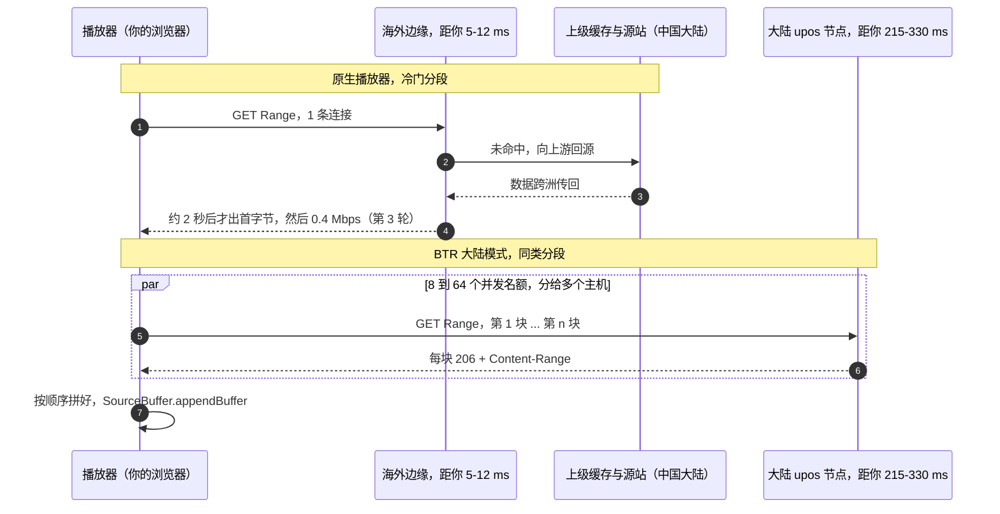
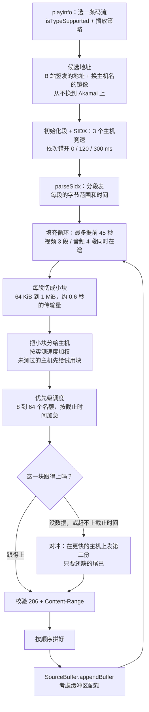

# 06 · 技术深挖：从 playurl 到屏幕上的每一帧

**简体中文** · [English](../en/06-technical-deep-dive.md) · [← 返回首页](../../README.md)

> **一句话**：在海外看 B 站视频，要过两道互不相干的关。冷数据得先从中国大陆取出来，再经由每段一条的长距离连接送到你这里（网络那一半）；每一帧还得在 60 帧下的 16.7 ms 内解码、合成完（本地那一半）。这一篇把两半都拆开讲：签名地址、缓存分层、TCP 算术、BTR 的调度器和 Chrome 的媒体链路。每处都给出处，推测会单独标出。

> [!NOTE]
> **怎么读这一篇。** 涉及代码的说法都链接到固定提交（BTR [`0302b34`][btr-c]、realzza [v0.5.0][rz-tag]、MBGTEB [1.9.0][mbg-tag]）；Chromium 的链接指向 `main`，并写明要搜的标识符。实测数据来自 [02](02-why-cdn.md) 的荷兰案例。凡是推断而不是观测到的，都标 **（推测）**。B 站没有公开它的地址签名方式和 CDN 合作细节，这部分写的是 2026 年 10 月观察到的行为，随时可能变。

**先看要点**

- 签名过的视频地址换到另一个 `*.bilivideo.com` 主机上照样能用；换到 Akamai 上就是 403。所有“换 CDN”的工具都建立在这个差别上。
- 三个冷门视频上，B 站分配的 Akamai 节点要等 **1792–2119 ms** 才出第一个字节；热门视频上只要 **69 ms**。
- 按教科书模型，往返 250 ms、丢包 0.1% 时，一条 TCP 连接的上限约 **1.8 Mbps**。冷门视频的瓶颈是跨洲回源加上每段只开一条连接，不是你家宽带。
- BTR = SIDX 索引 → 字节区间规划 → 优先级调度 → 对冲（重复）请求 → Media Source Extensions。
- 硬件加速关着的时候，Chrome 自己已经把 1080p60 AVC 记成“不流畅”：卡顿早被浏览器量过了。

**目录**

1. [B 站网页视频是怎么送到浏览器的](#1-b-站网页视频是怎么送到浏览器的)
2. [缓存分层：为什么冷门长尾视频在海外会卡](#2-缓存分层为什么冷门长尾视频在海外会卡)
3. [为什么一条长距离连接很慢](#3-为什么一条长距离连接很慢)
4. [BTR 从头到尾怎么工作](#4-btr-从头到尾怎么工作)
5. [你电脑上的播放链路](#5-你电脑上的播放链路)
6. [cdn-bench.js 怎么测，又会在哪里误导你](#6-cdn-benchjs-怎么测又会在哪里误导你)
7. [局限与注意事项](#7-局限与注意事项)
8. [来源](#来源)

## 1. B 站网页视频是怎么送到浏览器的

### 1.1 playurl：一份码流菜单

打开视频页时，播放器向 `api.bilibili.com/x/player/wbi/playurl` 要码流列表（请求带 WBI 签名；老的不签名接口 `/x/player/playurl` 仍然能用，BTR 用的就是它，参数 `fnval=4048` 表示“所有 DASH 码流”（[page-hook L733][btr-playurl]、[API 文档][api-ep]））。第一次的回答通常直接嵌在页面的 `window.__playinfo__` 里。请求 DASH 时，回答里有 `dash.video[]` 和 `dash.audio[]`，每个“清晰度 × 编码”一项（[API 文档][api-dash]）：

| 字段 | 含义 |
|---|---|
| `id` | 清晰度代码（qn）：16 = 360P，32 = 480P，64 = 720P，80 = 1080P，112 = 1080P+，116 = 1080P60，120 = 4K |
| `codecid` | 7 = AVC（H.264），12 = HEVC（H.265），13 = AV1 |
| `codecs` | RFC 6381 编码字符串，例如 `avc1.640032`；播放器用 `MediaSource.isTypeSupported()` 检查它 |
| `bandwidth` | 声明码率。MPEG-DASH 规定单位是比特每秒（社区文档写的是字节，但数值和 `cdn-bench.js` 的计算都对得上比特） |
| `baseUrl`、`backupUrl[]` | 同一个文件在主用主机和备用主机上的地址，每条都带签名 |
| `segment_base.initialization` | 初始化段（`ftyp` + `moov` box）的字节范围 |
| `segment_base.index_range` | `sidx` box 的字节范围，也就是所有媒体分段的索引 |

每个“清晰度 × 编码”是**一个完整视频的分片 MP4 文件**（`.m4s`），用 HTTP Range 请求按字节区间取（[RFC 9110 §14][rfc9110-range]），而不是成千上万个小文件。第 3 轮的视频（1080P60 AVC，声明码率 3.48 Mbps）就是一个约 1494 MB 的文件（[02 §2](02-why-cdn.md#2-荷兰案例测试环境)）。

### 1.2 B 站自己的播放器怎么用它

realzza 读过播放器源码，并在 Chromium 里核对过（[vod-routing.md][rz-player]）；BTR 的 README 对连接数也是同样的说法（[README L112][btr-readme-1conn]）：

- 播放器是 **dash.js 的一个分支**。每个码流有一个 `urls = [baseUrl, ...backupUrl]` 列表，和一个**粘住不动的下标**。
- 只有在**出错、约 2 秒内没收到首字节、或总超时**时才换到下一个地址；每个分段最多重试 3 次。
- **每个分段一个 `XMLHttpRequest`**，一条连接；最多提前缓冲 70–80 秒。

一个“很快应答、然后慢慢滴”的主机，一条规则都不会触发。第 3 轮里，B 站分配的 Akamai 节点只给了 **0.4 Mbps**，而声明码率是 **3.48 Mbps**，播放器却没有任何一条规则写着“太慢了，换一个”。

### 1.3 拆开一条签名视频地址

示意（全部是占位符；参数的种类和顺序因地址、因时间而异）：

```
https://upos-sz-mirrorXXX.bilivideo.com/upgcxcode/<aa>/<bb>/<id>/<id>-1-<stream>.m4s
  ?e=<不透明字符串>&uipk=<n>&nbs=1&deadline=<Unix 时间>&gen=playurlv3
  &os=<节点池>&og=<分组>&oi=<你的 IP，整数形式>&mid=<你的 UID>&platform=pc&trid=<追踪 ID>
  &upsig=<32 位十六进制>&uparams=e,uipk,nbs,deadline,gen,os,og,oi,mid,platform,trid
  &bvc=vod&nettype=0&orderid=0,3&bw=<码率>&...
```

| 参数 | 是什么 | 出处 |
|---|---|---|
| `deadline` | 过期时间（Unix 时间戳）。社区文档说地址有效期 120 分钟；`cdn-bench.js` 遇到过期地址会拒绝运行 | [API 文档][api-120]、[cdn-bench L127-128][cb-deadline] |
| `os` | 这条地址是给哪个节点池签发的：例如 `cosovbv`（海外腾讯边缘）、`akam`（Akamai）、`mcdn`（P2P / MCDN 节点） | [realzza][rz-hosts]、[API 文档示例][api-dash] |
| `og` | 新一些的地址里才有（值如 `hw`、`cos`）；没有文档，可能是回源或存储分组 **（推测）** | [API 文档示例][api-dash] |
| `oi`、`mid` | 你的 IP（32 位整数形式）和你的 UID（未登录时为 0）。**所以千万不要公开贴完整的 `.m4s` 地址** | [02 §8](02-why-cdn.md#8-自己测一次) |
| `platform=pc` | 网页码流会校验 `Referer`（必须在 `.bilibili.com` 下）且 UA 不能为空，否则 403 | [API 文档][api-referer]、[realzza][rz-hosts] |
| `upsig` | 签名（32 位十六进制）。算法和密钥都没有公开 | — |
| `uparams` | `upsig` 覆盖了哪些参数。**主机名不在其中** | [API 文档示例][api-dash] |
| `hdnts`（只在 Akamai 地址里） | Akamai EdgeAuth 令牌：有效期、路径或 ACL，再加一个 HMAC，由 Akamai 边缘用客户配置里的密钥校验 | [realzza][rz-hosts]、[Akamai EdgeAuth][akamai-edgeauth] |

### 1.4 为什么换主机名后镜像节点认签名，Akamai 不认

**我们和别人观察到的**

- 第 3 轮里，一条非 Akamai 的地址只改主机名，换到的 8 个主机（aliov、香港、ali、hw、08c、cos、bd、estgoss）都给了数据，只是速度差别很大（[02 §3](02-why-cdn.md#3-第-3-轮登录后-1080p60最贴近日常观看)）。`cdn-bench.js` 从不把地址换到 Akamai 上（[L134-148][cb-nodes]）。
- realzza 在美国西海岸测到：`os=cosovbv` 的地址被节点池里每一个 UPOS 镜像接受；Akamai 地址带 `os=akam` 和 `hdnts` 令牌，把别的地址换到 Akamai 上会被 403 拒绝（[vod-routing.md L115][rz-hosts]）。PiliPlus 用户也报告过从 Akamai 地址起步换主机会 403（[#3242][pili3242]）。
- BTR 拒绝把别的节点的地址放到 `*.akamaized.net` 上（[`swapOrdinaryHost`，L44-57][btr-swap]）。它的源码注释还说：当账号只拿到 Akamai 地址时，`*.bilivideo.com` 节点“也接受这些签名”，所以只在这种情况下，BTR 会把 Akamai 地址换到这些节点上（[L74-85][btr-donor]）。
- MBGTEB 的源码在一个方向上说法一致，另一个方向更谨慎：upos 签名放到 Akamai 上会被 403 拒绝（已验证），Akamai 签名放到别处“未验证”，排在最后尝试（[candidates.ts L42-46][mbg-cand]）。

**最可能的解释（推测）**

- `upsig` 签的是 `uparams` 里列出的参数，不包括主机名；而 `*.bilivideo.com` 名下的各个节点显然用同一种方式校验。所以同一条签名地址在它们之间通用。有意思的是，`os` 在签名列表里，由 `mirrorhw` 提供服务时它仍然写着 `cosovbv`，说明节点并不拿 `os` 和自己的身份比对。
- Akamai 是第三方 CDN，执行它自己的令牌校验。给 `bilivideo` 主机签发的地址里没有 Akamai 边缘能校验的 `hdnts`，于是 403。据说反方向能用（BTR 的注释这么说；MBGTEB 认为未验证），如果属实，说明 Akamai 签发的地址除了 `hdnts` 也带着普通的 `upsig` 参数。
- 这些 B 站都没有写进文档。规则变过时，换 CDN 的工具就坏过（[04 §A 第 4、6 行](04-alternatives.md#a-浏览器里脚本--扩展)）；改写 CDN 地址也可能不符合 B 站用户协议（[04 §E](04-alternatives.md#e-法律与存续风险)）。

## 2. 缓存分层：为什么冷门长尾视频在海外会卡

### 2.1 三层结构：B 站自己的说法

- **B 站公网架构文章**（[BTR README L128-134][btr-readme-arch] 引用并附了截图；原页面对自动读取会弹验证码）：**边缘节点**规模小，“缓存热门数据”；**区域级骨干节点**为边缘节点承接容量溢出和故障备份，相当于二级缓存；**核心 IDC**（源站）拥有全部资源。
- **《B站下行CDN架构的探索与应用》**（哔哩哔哩技术，2024-04-23，[链接][bili-cdn2024]；我们只读到了摘录）：边缘集群里，网关节点后面有一个回源收敛组件，把未命中请求合并后再往上游取；热点内容会被识别出来并预热。
- **一位 B 站工程师的 QCon 2023 演讲预告**，讲的是 B 站电视端（[InfoQ][infoq-tv]）：4K 视频“本质上是冷资源”，按原有 CDN 回源流程卡顿率超过 5%，改为中央存储 + 边缘 POP 之后降到 1.5% 左右。就算在国内，冷内容走回源路径也会卡。
- **在海外**，边缘通常是第三方 CDN。在荷兰：Akamai 的本地节点、经腾讯 EdgeOne 的 cosov、阿里云荷兰节点上的 aliov（[02 §6](02-why-cdn.md#6-其它网络观测同一天同一台电脑)）。它们给 B 站配置的上级缓存是什么样，并不公开；Akamai 自己的 [Tiered Distribution][akamai-tiered] 会把上级节点放在“靠近源站”的位置。

### 2.2 一次冷缓存未命中要付出什么



| | 热门（边缘有数据） | 冷门（边缘要去取） |
|---|---|---|
| Akamai，单连接 | **63.1 Mbps**，首字节 **69 ms**（第 1 轮） | **0.4–5.7 Mbps**，首字节 **1792–2119 ms**（第 1–3 轮） |
| realzza 的实测（美国西部） | 有缓存的边缘 30–60 ms 应答 | 首字节 1.4–11.5 秒，然后 1–8 Mbps（[L121][rz-time]） |

为什么长尾永远是冷的：第 3 轮的视频只有 65 次播放，文件约 1494 MB。你所在地区恰好有人把第 10 分钟那段字节拉进欧洲边缘的概率几乎为零。热门视频的字节，在你之前已经被成千上万人拉过了。同一个边缘、同一条线路，结果完全相反：**差别在热度，不在地理**。

### 2.3 为什么大陆节点和并行请求有用

- **大陆节点**（推测）：它们紧挨着区域层和核心层，在那里未命中只是一次国内回源。剩下的问题是到你这里的长往返路径，这是 TCP 的问题（§3），可以用并行解决。
- **冷数据上的并行**：每个在途请求都会触发自己的上游回源，8 个并发区间就是 8 路并发回源。热数据不用回源，一条连接已经接近满速，所以热门视频上并行几乎没有收益（[02 §5](02-why-cdn.md#5-三个冷门视频的共同规律)）。
- **冷数据对 Akamai 并行反而更慢**（0.5–0.7 Mbps，还有超时）。我们看不到 Akamai 内部；可能的原因是同一对象的并发未命中被合并成一次上游回源，再加上 HTTP/1.1 主机最多 6 条连接（§3.4）**（推测）**。

## 3. 为什么一条长距离连接很慢

### 3.1 Mathis 上限：以 250 ms 为例算一遍

对基于丢包的（Reno 类）TCP 流，Mathis 等人（[1997][mathis]）给出了稳态上限：

```
吞吐 ≤ (MSS / RTT) × (C / √p)        C = √(3/2) ≈ 1.22
```

取 MSS = 1460 字节（11,680 比特）：RTT = 250 ms 时，MSS / RTT = 46.7 kbit/s。再乘以 1.22 / √p：

| 丢包率 p | RTT 5 ms（本地边缘） | RTT 250 ms（欧洲 ↔ 大陆） |
|---:|---:|---:|
| 1% | 28.6 Mbps | 0.57 Mbps |
| 0.1% | 90 Mbps | 1.8 Mbps |
| 0.01% | 286 Mbps | 5.7 Mbps |
| 0.001% | 905 Mbps | 18.1 Mbps |

丢包率一样，往返时间变成 50 倍，吞吐就变成 1/50。要在 250 ms 上用一条这样的流跑出 5.2 Mbps（1.5 × 3.48），丢包率得低于约 0.012%，大约 8,000 个包才丢 1 个，而这条路要经过好几家运营商。注意：发送端的拥塞控制由 CDN 决定，不由你决定。CUBIC 有一个 Reno 友好模式（[RFC 9438 §4.3][rfc9438]），除此之外丢包后窗口恢复得比 Reno 快；BBR 根本不以丢包为信号。所以这张表只看数量级，不是预测。

### 3.2 慢启动吃掉短样本

一条新连接起步约 10 个分段（14.6 KB，[RFC 6928][rfc6928]），之后每个往返大约翻一倍。传 2 MB（2 MiB）需要 8 轮数据，也就是大约 8 个往返。在 250 ms 上，**已经建好的连接约要 2–2.25 秒（≤ 7.5–8.4 Mbps）**；**新连接还要多花约 0.5 秒做 TCP 和 TLS 1.3 握手，约 2.5–2.75 秒（≤ 6.1–6.7 Mbps）**。就算零丢包、服务器无限快也是这样。第 3 轮里大多数大陆单连接结果（2.3–6.9 Mbps）都落在这个范围里，所以它们几乎说明不了节点的真实能力。realzza 看到的也一样：大陆镜像在前 768 KB 里看起来只有 6–10 Mbps，之后能稳定在 38–84 Mbps（[L121][rz-time]、[L50-66][rz-probe]）。CDN 可能用更大的初始窗口，所以这只是示意。

满速时管道里还得装下很多数据：26.3 Mbps × 250 ms ≈ 800 KiB 在途。Windows 的接收窗口自动调优通常够用；不要关掉它（[04 §F](04-alternatives.md#f-不推荐清单及原因)）。

### 3.3 跨节点并行分段下载

- **N 条独立的流 ≈ N × 单流上限**，前提是瓶颈在单流本身（丢包 × 往返），而不是你的接入带宽。长连接只付一次慢启动的代价。
- **不同主机意味着不同的服务器路径和不同的上游回源**，这在冷数据上最重要（§2.3）。
- **这是有代价的。** HTTP/1.1 规范要求客户端开多连接时保持克制，提醒多连接在拥塞网络里会有副作用，还指出服务器可能把看起来像滥用的流量拒掉（[RFC 9112 §9.4][rfc9112]）。BTR 的自动模式里，阶梯最低一级是 8 个名额，每次开始播放至少先开 16 个（[L124-151][btr-ladder]）；遇到 HTTP 412 / 429 会退回（[L320-322][btr-auto-signals]、[L632-635][btr-sample]）。手动固定线程数则不会退回。

### 3.4 HTTP/2 的坑：多路复用与连接合并

- **多路复用**：在浏览器里，发往**同一个** HTTP/2 主机的所有并行区间，都是**同一条** TCP 连接上的流：只有一个拥塞窗口，丢一个包所有流都得等（TCP 队头阻塞）。所以对一个 HTTP/2 主机的“8 路并行”并不是 8 条 TCP 流。在冷数据上，它的收益来自 8 路并发回源；在 `cdn-bench.js` 里，它还沾了单连接测试刚刚“热”好的那条连接的光。
- **连接合并**：HTTP/2 允许客户端把一条连接复用给另一个主机名，只要服务器对它有权威，也就是证书覆盖了它（[RFC 9113 §9.1.1][rfc9113]）。据 [Stenberg 的文章][coalesce]，Chrome 的做法是：新主机名的 DNS 结果里包含现有连接的 IP，就复用。upos 主机出示的是 `*.bilivideo.com` 通配符证书（我们查过的主机都是这样），而 hw、08c、08h、hwo1、08ct 解析到同一组地址（[02 §6](02-why-cdn.md#6-其它网络观测同一天同一台电脑)）。所以“五个节点”可能只是一条路径上的一条连接。
- **一个值得验证的假设**：第 3 轮里大陆单连接最好的是 08c（18.1 Mbps，首字节 606 ms）。`cdn-bench.js` 测它紧接在 hw 之后，而两者共用 IP。如果 Chrome 复用了 hw 那条已经“热”好的连接，这个数字量的就是一条热连接，而不是 08c 自己的路径。没有验证过；用 `chrome://net-export` 抓一份日志就能看出来。
- **HTTP/1.1 主机**（Akamai 和 estgoss 只协商出 HTTP/1.1）：Chrome 对每个主机最多开 **6 条连接**（[Chromium `client_socket_pool_manager.cc`][cr-sockets]，`g_max_sockets_per_group`），所以 8 路并行实际是 6 条加 2 个排队。MBGTEB 正是因为这个，把每个主机限制在 6 路（[engine.ts L48-52][mbg-caps]）。

## 4. BTR 从头到尾怎么工作

下面说的都是 BTR 提交 [`0302b34`][btr-c]（v2026.10.8.1），也就是审计过的版本（[03](03-btr-security-audit.md)）。以后的版本里常数随时可能变。



### 4.1 接管与选轨

- **全接管**（默认，[bridge.js L10][btr-defaults]）在页面的 `<video>` 上建自己的 `MediaSource`，加一个视频、一个音频 `SourceBuffer`（[native-mse-player L922-966][btr-ms]）。**兼容模式**让 B 站播放器继续负责解码、缓冲和切换清晰度，BTR 只替它下载媒体请求（[native-range-transport L10-13][btr-compat]）。
- 选轨时只保留 `MediaSource.isTypeSupported()` 接受的码流，播放器菜单里选的编码排第一，否则按 **AV1 > HEVC > AVC**（[L84-109][btr-codec]、[L114-147][btr-select]）。所以 [05 ⑥](05-safe-install.md#2-安装配方tampermonkeychrome--edge) 要求明确选编码：“能播”不等于“硬解”（§5.2）。

### 4.2 先拿索引：初始化段和 SIDX

- 每条轨道并行下载初始化段和索引两个区间（[L520-555][btr-loadtrack]），每个区间最多让 3 个候选主机竞速，依次错开 0、120、300 ms 启动（[idm L883-914][btr-meta]）。
- [`parseSidx`][btr-sidx] 解析 ISO BMFF 的 `sidx` box：从 `first_offset` 往后，每条引用给出一段的字节数和时长，BTR 由此算出一张绝对字节范围和起始时间的表（[L60-89][btr-sidx-ref]）。拖动进度条就是在这张表里二分查找（[`segmentIndexAt`，L98-111][btr-seek]）。按 [MSE ISO BMFF 字节流格式][mse-isobmff] 的要求，先写入初始化段（`ftyp` + `moov`）。

### 4.3 分段规划

- **提前多少**：填充循环最多提前缓冲 `bufferAheadSeconds = 45` 秒（[range-core L126][btr-settings]、[L636-638][btr-fill]），滑动窗口里同时有 3 个视频段或 4 个音频段在途。第一段优先级 120，之后每往后一段从 55 起减 5（最低 30）；10 秒内就要播到的段标记为加急（[L663-676][btr-fill]）。
- **切块**：每段最多切成 `concurrency` 块（[`splitRange`，range-core L35-50][btr-split]）。块的大小跟着实测的单连接速度走（约 0.6 秒的传输量，下限 64 KiB，上限 1 MiB），免得长线路上往返时间占了大头（[idm L405-415][btr-chunk]）。每 8 个名额留 1 个给救援（[L1143-1148][btr-range]）。
- **哪块给哪个主机**：候选来自解析器（[cdn-resolver L248-282][btr-cands]）；按实测速度做平滑加权轮询分配，比最快节点慢 12 倍以上的节点被剔除，没测过的节点从区间末尾拿一两块试用块（[idm L916-981][btr-assign]）。速度测量 90 秒后过期，慢节点会再得到一次机会（[L183][btr-ttl]）。

### 4.4 优先级调度与自动线程数

- 一个信号量，三个队列等级依次服务：关键（探测、初始化段、索引）、起播块、其它（[L18-20、L33-122][btr-sem]）。同一等级内，已过截止时间 +12，离截止 0.75 秒内 +9，2 秒内 +6；带截止时间的普通请求每多等 0.9 秒再加 20 分，旧请求不会一直被插队（[L53-74][btr-urgency]）。一块的截止时间，就是播放头走到它所在分段的时刻，并按播放倍速换算（[native-mse-player L21-24][btr-mse-const]）。
- **自动线程数**（默认开启）：阶梯为 **8 → 12 → 16 → 24 → 32 → 48 → 64**；每次新开始播放（换视频，或拖到缓冲区以外）至少从 16 起步，缓冲充足后再回到页面原来的级别（[L124-151][btr-ladder]）。遇到卡顿、缓冲低于 6 秒且不再增长但数据还在来、或连接排队等首字节，就往上加一级。每加一级都是 10 秒的试用期，吞吐没涨就退回，并让这一级休息 90 秒；遇到 HTTP 412 / 429 就降一级，并在 180 秒内不再爬到这一级（[L242-260][btr-trial]、[L287-338][btr-auto-signals]）。播放器把缓冲量和 `waiting` 事件喂给它（[L1105-1120][btr-autofeed]）。

### 4.5 对冲请求

- 每块最多 3 轮、总共 25 秒，轮间先暂停 0.5 秒、再暂停 1 秒（[`downloadPiece`，L696-865][btr-piece]）。每一轮里主机两两一组：第一份立即发出，过了对冲延迟后由 [`hedgeDue`][btr-hedgedue] 决定要不要发**第二份（对冲）**。第一份一个字节都没收到，或整整一个延迟都没有新数据，就发。否则只有在第一份赶不到“截止前 1.5 秒”**并且**满足以下之一时才发：另一个主机已知快 1.5 倍以上；第一份的速度低于平常单连接速度的 0.6 倍；另一个主机还没测过速。
- 对冲延迟是平常一块耗时的 1.5 倍，限制在 250–900 ms（[L417-423][btr-hedgedelay]）；起播块只等 200–250 ms。
- **不会重复下载**：第二份只要第一份还没送到的那部分（第一份已收到至少 32 KiB 时），然后把两段拼起来（[L707-724][btr-resume]）。先完成的一份胜出，另一份被中止；输掉的那份收到的数据也会记成一次测速样本（[L621-635][btr-sample]）。
- **完整性与隐私**：每个回应都必须是 `206`，`Content-Range` 必须与这一块完全一致；请求用 `credentials: "omit"`，`Referer` 只带页面的源（[L595-612][btr-fetch]）。超时：首字节 5.5 秒、传输停滞 4 秒、总计 15 秒（[range-core L117-126][btr-settings]）。一个节点两次失败且一个字节都没给，就在这个视频剩下的时间里被跳过；HTTP 4xx 用来区分是节点的问题还是地址的问题（[cdn-resolver L109-178][btr-ban]）。两个主机报告的文件总长度不一致，这个区间就判失败（[idm L1191-1192][btr-range]）。

### 4.6 写入 Media Source Extensions

- **起播**：第一段先用 64 KiB 的探测块在多个主机间竞速，之后各块按顺序一到就写入，不等整段下完（[L1020-1119][btr-startup]）。起播前缓冲多少秒（2.5–10 秒），取决于实测吞吐和码率之比（[native-mse-player L10-11、L600-616][btr-startprofile]）。
- **写入**按每个 `SourceBuffer` 排队，等 `updateend` 后再写下一块（[L464-509][btr-append]）。遇到 `QuotaExceededError` 时，BTR 释放 5 秒以前已经播过的数据，并调低提前缓冲的目标（Chromium 默认每条流的上限是视频 150 MB、音频 12 MB，见 [`demuxer_memory_limit.h`][cr-memlimit]）。播完时调用 `endOfStream()`（[L737-771][btr-eos]）。这些接口由 [MSE 规范][mse] 定义。
- **荷兰案例**（钉版本的 BTR，硬件加速已开，第 3 轮那个冷门视频从 10:00 开始，1080P60）：拖动后 **3.2 秒**开始播放，之后 40 秒 **0 次卡顿**；5 秒时前方缓冲 **28 秒**，10 秒时到达 **45 秒**上限；**2502 帧只丢 1 帧（0.04%）**（[02 §3](02-why-cdn.md#3-第-3-轮登录后-1080p60最贴近日常观看)）。对照：B 站分配的 Akamai 节点单连接 0.4 Mbps、8 路并行 0.7 Mbps，而需要的是 3.48 Mbps；大陆的 hw 和 bd 8 路并行分别是 26.3 和 25.5 Mbps。这只是一次观察，不是 A/B 测试。

### 4.7 三种设计对比

| | B 站自己的播放器 | realzza v0.5.0 | MBGTEB 1.9.0 Thread Ripper | BTR `0302b34` 全接管 |
|---|---|---|---|---|
| 挂在哪里 | — | 播放器自己的 XHR（[vod-routing][rz-race]） | 包住播放器的 XHR，用自己拼好的数据作为回应（[engine.ts L1-21][mbg-doc]） | 换掉媒体源，缓冲和调度都由它负责 |
| 每段几条连接 | 1 | 1（整场切到胜出的主机） | 最多 16 块；每主机 ≤ 6，总计 ≤ 32（[L44-57][mbg-caps]） | 8–64 个名额，自动 |
| 用哪些主机 | 签发的主地址 + 备用地址 | 签发的主机 + 镜像池（ali、hw、tf-all-hw、tf-all-tx、cos、aliov、hwov）（[L165][rz-cands]） | 签发的地址 + 14 个种子主机，含 Akamai；签名换到另一家族的主机上时排在最后尝试（[candidates.ts L69-89][mbg-seeds]）；每个视频分别给每个主机测速 | 大陆、海外或自定义列表；签发的地址参与第一个请求的竞速（选了自定义节点时除外，[L284-297][btr-startcands]），之后的分段只保留符合所选模式的签发地址（[L86-91][btr-allowed]），所以大陆模式下，B 站分配的海外地址（如 Akamai、cosov）会被丢掉 |
| 什么时候出手 | 出错、约 2 秒无首字节、总超时 | 1 秒无首字节，或低于所需码率的 1.3 倍（[L183][rz-trigger]）；胜出者快 1.5 倍以上才切换（[L203][rz-switch]） | 开启后一直工作（默认关闭，[thread-ripper.ts L7][mbg-off]） | 装上后一直工作 |
| 块大小 | 整个分段 | 整个分段 | 约 1 秒的传输量，192 KiB–4 MiB（[L1212-1221][mbg-pieces]） | 约 0.6 秒的传输量，64 KiB–1 MiB |
| 兜底 | dash.js 重试 | 合成一次超时，让播放器立刻重试（[L213][rz-synth]）；每个视频最多切换 4 次 | 不同主机返回的重叠字节互相比对，不一致就中止（[L1227-1245][mbg-mismatch]）；最后退回浏览器自己的请求 | 206 + Content-Range 校验、总长度校验、封禁列表、重试；失败时把视频交还给 B 站播放器 |

取舍很清楚：realzza 动得最少，只在“换一个节点、一条连接就够”时有用；MBGTEB 和 BTR 并行下载，这正是 §2–§3 说冷内容需要的，代价是请求更多、在页面里运行的代码更多（[03](03-btr-security-audit.md)）。

## 5. 你电脑上的播放链路

### 5.1 从 SourceBuffer 到解码器

1. `appendBuffer()` 把 fMP4 字节交给 Chromium 的解复用器，拆成一帧帧压缩数据。
2. **选解码器**：启用了 GPU 视频解码时，Chromium 先试平台解码器；源码注释的意思是“优先用外部解码器，因为只有硬件加速时它才存在”（[`default_decoder_factory.cc`][cr-decoders]）。在 Windows 上就是 `D3D11VideoDecoder`。否则退回软件解码：AV1 用 `Dav1dVideoDecoder`，H.264 用 `FFmpegVideoDecoder`。Chrome 里 HEVC 没有软件后备（[`media_options.gni`][cr-hevc]），所以关掉硬件加速，HEVC 就直接不可用。
3. **合成**：开着硬件加速时，解码出的帧留在 GPU 上，由合成器和页面、弹幕层混合。关掉时，Chrome 用 [SwiftShader][swiftshader]，也就是 GPU 接口的 CPU 实现来渲染（荷兰案例里 GPU 进程的启动参数是 `--use-angle=swiftshader-webgl`，见 [01 §2](01-diagnosis.md#2-第一步硬件加速开了吗)）。

### 5.2 mediaCapabilities 到底报告了什么

[`navigator.mediaCapabilities.decodingInfo()`][mc-spec] 返回 `supported`、`smooth`、`powerEfficient`。在 Chromium 里（[`media_capabilities.cc`][cr-mc]）：

- **`powerEfficient`** 是去问 GPU 视频解码器支不支持这种配置（功能开关 `MediaCapabilitiesQueryGpuFactories`，默认开启，见 [`media_switches.cc`][cr-switches]）。所以它可以当作“是否硬解”的代理指标。
- **`smooth`** 来自这个浏览器配置文件**自己的播放历史**：过去播放同类配置时丢帧不超过 5%，就算流畅；没有历史时，Chrome 乐观地回答 `true`（[`video_decode_perf_history.cc`][cr-perf]）。
- 如果某个编码不省电、又没有内置的软件解码器，Chromium 会把 `supported` 改成 `false`。关掉硬件加速时的 HEVC 就是这种情况。

所以荷兰案例里 1080p60 的 `AVC smooth=false`（[01 §2](01-diagnosis.md#2-第一步硬件加速开了吗)）说明：Chrome 在这个配置文件里，已经给这类码流记下了超过 5% 的丢帧。卡顿不是感觉，浏览器早就量过了。

### 5.3 为什么缓冲满了，软解还是卡

60 帧时每一帧只有 **16.7 ms**，关键路径上的事都得在这段时间里做完：解码、颜色转换和上传、和页面及弹幕层合成，然后在下一次垂直同步时显示。缓冲再满，也只保证**压缩后的**数据已经到手，对 CPU 时间毫无帮助。一帧赶不上它的显示时刻，Chrome 就把它丢掉，这就是 `getVideoPlaybackQuality().droppedVideoFrames` 统计的东西（也是 [`play-monitor.js`](../../tools/play-monitor.js) 读的数）。音频有自己的时钟，照常播放，于是出现典型的“声音正常、画面一顿一顿”（[01 §1](01-diagnosis.md#1-两类卡顿表现不一样)）。关掉硬件加速时，解码、合成和弹幕层都在抢同一颗 CPU，1080P60 不管网速多快都会超时。AV1 软解（dav1d）更费，而播放策略选“默认”时可能恰好选中它（[01 §4](01-diagnosis.md#4-编码播放策略怎么选)）。

| 荷兰案例 | 硬件加速关 | 硬件加速开 |
|---|---|---|
| WebGL 渲染器 | SwiftShader | GPU，经 ANGLE（Direct3D 11） |
| HEVC | `supported=false` | 硬件解码 |
| AV1 | `powerEfficient=false`（软解，dav1d） | 硬件解码 |
| AVC 1080p60 | `smooth=false`，`powerEfficient=false` | — |
| B 站下发的轨道 | 只有 AVC（`codecid` 7） | AVC + HEVC + AV1 |
| 钉版本 BTR 播放冷门 1080P60 | — | 40 秒 0 次卡顿，丢帧 0.04% |

为什么一开始 B 站只下发 AVC：播放器似乎只请求、或只保留浏览器说自己能播的编码 **（推测；我们没有追踪播放器代码）**。

## 6. cdn-bench.js 怎么测，又会在哪里误导你

### 6.1 方法

| 步骤 | [`cdn-bench.js`](../../tools/cdn-bench.js) 做了什么 | 行号 |
|---|---|---|
| 选轨道 | 读 `__playinfo__`，用页面已经请求过的 `.m4s` 路径（Resource Timing）来匹配；地址的 `deadline` 已过就停止 | [L105-131][cb-track] |
| 组装节点列表 | B 站分配的主、备节点，再加 3 个海外和 6 个大陆主机，做法是把一条**非 Akamai** 的签发地址换主机名；Akamai 只用它自己的地址测 | [L134-148][cb-nodes] |
| 干净的 `fetch` | 从一个隐藏的空白 iframe 借原生 `fetch`，改写过 `fetch` 的脚本就干扰不了；`credentials: 'omit'`、`cache: 'no-store'` | [L150-157][cb-fetch] |
| 规划区间 | 先用 `Range: bytes=0-0` 读出文件大小，再给每个节点、每项测试分配文件 25%–90% 之间各自不同、随机错开、按 64 KiB 对齐的区间 | [L185-205][cb-plan] |
| 测量 | 每个节点：先一个 2 MB 请求，再 8 个各 256 KiB 的并行请求。Mbps = 字节数 × 8 ÷ 从发出请求到最后一个字节的时间，所以包含了首字节时间；超时的请求也按已收到的字节计算 | [L159-181、L207-229][cb-measure] |
| 结论 | 和当前轨道声明码率的 1.5 倍比较；设了 `TARGET_MBPS` 就和它比较 | [L232-263][cb-verdict] |

### 6.2 陷阱

1. **“冷”只有一次。** 只有第一次读某段字节才是冷的。同一个视频再测一次会读别的随机区间，但文件可能已经有一部分在边缘上热了；请换一个你从没看过的视频。
2. **慢启动**：2 MB 的单连接样本，光是慢启动就把上限压到 250 ms 时约 6–8 Mbps；在实测的 200–330 ms 往返范围里约 5–10 Mbps（§3.2）。在意大陆单连接数字时，把 `SINGLE_MB` 改成 8。
3. **测试顺序的影响**：单连接测试负责建（或复用）连接，并行测试趁热用它。共用 IP 的主机可能被合并到同一条连接上（§3.4）。
4. **HTTP/1.1 主机**：在 Akamai 和 estgoss 上，“8 路并行”最多是 6 条连接加 2 个排队请求。
5. **未登录 = 低码率**：第 2 轮只拿到 360P（0.40 Mbps），所以结论说“热”。请登录后用你常看的清晰度测，或设置 `TARGET_MBPS`（6 ≈ 1080P+；1080P60 AVC 请参考“视频统计信息”里的 Video DataRate）。
6. **声明值不是平均值**：`bandwidth` 来自清单，MPEG-DASH 把它定义为“先缓冲一段后能连续播放”的速率，更接近峰值而不是平均值。1.5 倍的门槛是故意留的余量。
7. **一次样本、一个时段**：国内晚高峰（北京时间 19–23 点）能让结果差到 10 倍（[02 §7](02-why-cdn.md#7-为什么这些数字只能当方向参考)）。
8. **测的是能力，不是体验**：这个工具量的是节点能给多少；几个节点的并行结果不能相加，加速脚本实际能跑多快取决于它的调度器（§4）。要看实际体验，请用 `play-monitor.js` 和 [05 §5](05-safe-install.md#5-ab-测试找到最适合你的设置) 的 A/B 流程。

## 7. 局限与注意事项

- 代码层面的结论来自对上述固定提交的静态阅读，我们没有运行这些仓库里的代码；以后的版本里常数可能不同。
- B 站的签名方式、CDN 合作和缓存分层都没有公开。§1.4 和 §2 写的是观察到的行为和公开过的片段，不是规范。
- 网络数据来自一个地点（荷兰）、一天、单次样本（[02 §7](02-why-cdn.md#7-为什么这些数字只能当方向参考)）。
- 改写 CDN 地址的工具可能不符合 B 站用户协议，也随时可能失效（[04 §E](04-alternatives.md#e-法律与存续风险)）。这里没有任何内容用于绕过付费、大会员、DRM、地区限制或登录。

## 来源

**B 站官方或 B 站工程师**：[《B站下行CDN架构的探索与应用》（2024）][bili-cdn2024] · [《B站公网架构实践及演进》，见 BTR README 的引用][btr-readme-arch] · [QCon 2023 演讲预告（InfoQ）][infoq-tv]

**社区文档**：[bilibili-API-collect：视频流 URL][api-dash]（2026-01 已归档）

**项目（固定版本）**：[BTR `0302b34`][btr-c] · [realzza `vod-routing.md` @ v0.5.0][rz-player] · [MBGTEB Thread Ripper 引擎 @ 1.9.0][mbg-doc] · [PiliPlus #3242][pili3242]

**标准**：[RFC 9110 §14（Range 请求）][rfc9110-range] · [RFC 9112 §9.4][rfc9112] · [RFC 9113 §9.1.1][rfc9113] · [RFC 6928][rfc6928] · [RFC 9438][rfc9438] · [Media Source Extensions][mse] · [MSE ISO BMFF 字节流格式][mse-isobmff] · [Media Capabilities][mc-spec]

**TCP 与 HTTP**：[Mathis 等，1997][mathis] · [Daniel Stenberg：HTTP/2 连接合并][coalesce] · [Akamai EdgeAuth 令牌][akamai-edgeauth] · [Akamai Tiered Distribution][akamai-tiered]

**Chromium 源码**：[解码器工厂][cr-decoders] · [HEVC 编译选项][cr-hevc] · [MediaCapabilities][cr-mc] · [解码性能历史][cr-perf] · [媒体功能开关][cr-switches] · [MSE 内存上限][cr-memlimit] · [每主机连接数][cr-sockets] · [SwiftShader][swiftshader]

---

上一篇：[05 · 安全安装 BTR](05-safe-install.md) · [返回首页](../../README.md)

<!-- 链接。BTR 固定在提交 0302b34；realzza 固定在 v0.5.0（1f2726b）；MBGTEB 固定在 1.9.0（09b0ee3）；cdn-bench 指向本仓库。 -->
[btr-c]: https://github.com/MrTangLuyao/Bilibili-thread-ripper/commit/0302b345cdfe367ac599b52dc6874e3f7967e220
[btr-readme-1conn]: https://github.com/MrTangLuyao/Bilibili-thread-ripper/blob/0302b345cdfe367ac599b52dc6874e3f7967e220/README.md?plain=1#L112
[btr-readme-arch]: https://github.com/MrTangLuyao/Bilibili-thread-ripper/blob/0302b345cdfe367ac599b52dc6874e3f7967e220/README.md?plain=1#L128-L134
[btr-playurl]: https://github.com/MrTangLuyao/Bilibili-thread-ripper/blob/0302b345cdfe367ac599b52dc6874e3f7967e220/src/page-hook.js#L733
[btr-defaults]: https://github.com/MrTangLuyao/Bilibili-thread-ripper/blob/0302b345cdfe367ac599b52dc6874e3f7967e220/src/bridge.js#L10
[btr-split]: https://github.com/MrTangLuyao/Bilibili-thread-ripper/blob/0302b345cdfe367ac599b52dc6874e3f7967e220/src/range-core.js#L35-L50
[btr-settings]: https://github.com/MrTangLuyao/Bilibili-thread-ripper/blob/0302b345cdfe367ac599b52dc6874e3f7967e220/src/range-core.js#L117-L126
[btr-sidx]: https://github.com/MrTangLuyao/Bilibili-thread-ripper/blob/0302b345cdfe367ac599b52dc6874e3f7967e220/src/sidx.js#L13-L96
[btr-sidx-ref]: https://github.com/MrTangLuyao/Bilibili-thread-ripper/blob/0302b345cdfe367ac599b52dc6874e3f7967e220/src/sidx.js#L60-L89
[btr-seek]: https://github.com/MrTangLuyao/Bilibili-thread-ripper/blob/0302b345cdfe367ac599b52dc6874e3f7967e220/src/sidx.js#L98-L111
[btr-swap]: https://github.com/MrTangLuyao/Bilibili-thread-ripper/blob/0302b345cdfe367ac599b52dc6874e3f7967e220/src/cdn-resolver.js#L44-L57
[btr-donor]: https://github.com/MrTangLuyao/Bilibili-thread-ripper/blob/0302b345cdfe367ac599b52dc6874e3f7967e220/src/cdn-resolver.js#L74-L85
[btr-ban]: https://github.com/MrTangLuyao/Bilibili-thread-ripper/blob/0302b345cdfe367ac599b52dc6874e3f7967e220/src/cdn-resolver.js#L109-L178
[btr-ttl]: https://github.com/MrTangLuyao/Bilibili-thread-ripper/blob/0302b345cdfe367ac599b52dc6874e3f7967e220/src/cdn-resolver.js#L180-L183
[btr-cands]: https://github.com/MrTangLuyao/Bilibili-thread-ripper/blob/0302b345cdfe367ac599b52dc6874e3f7967e220/src/cdn-resolver.js#L248-L282
[btr-startcands]: https://github.com/MrTangLuyao/Bilibili-thread-ripper/blob/0302b345cdfe367ac599b52dc6874e3f7967e220/src/cdn-resolver.js#L284-L297
[btr-allowed]: https://github.com/MrTangLuyao/Bilibili-thread-ripper/blob/0302b345cdfe367ac599b52dc6874e3f7967e220/src/cdn-resolver.js#L86-L91
[btr-sem]: https://github.com/MrTangLuyao/Bilibili-thread-ripper/blob/0302b345cdfe367ac599b52dc6874e3f7967e220/src/idm-downloader.js#L18-L122
[btr-urgency]: https://github.com/MrTangLuyao/Bilibili-thread-ripper/blob/0302b345cdfe367ac599b52dc6874e3f7967e220/src/idm-downloader.js#L53-L74
[btr-ladder]: https://github.com/MrTangLuyao/Bilibili-thread-ripper/blob/0302b345cdfe367ac599b52dc6874e3f7967e220/src/idm-downloader.js#L124-L151
[btr-trial]: https://github.com/MrTangLuyao/Bilibili-thread-ripper/blob/0302b345cdfe367ac599b52dc6874e3f7967e220/src/idm-downloader.js#L242-L260
[btr-auto-signals]: https://github.com/MrTangLuyao/Bilibili-thread-ripper/blob/0302b345cdfe367ac599b52dc6874e3f7967e220/src/idm-downloader.js#L287-L338
[btr-chunk]: https://github.com/MrTangLuyao/Bilibili-thread-ripper/blob/0302b345cdfe367ac599b52dc6874e3f7967e220/src/idm-downloader.js#L405-L415
[btr-hedgedelay]: https://github.com/MrTangLuyao/Bilibili-thread-ripper/blob/0302b345cdfe367ac599b52dc6874e3f7967e220/src/idm-downloader.js#L417-L423
[btr-hedgedue]: https://github.com/MrTangLuyao/Bilibili-thread-ripper/blob/0302b345cdfe367ac599b52dc6874e3f7967e220/src/idm-downloader.js#L425-L456
[btr-fetch]: https://github.com/MrTangLuyao/Bilibili-thread-ripper/blob/0302b345cdfe367ac599b52dc6874e3f7967e220/src/idm-downloader.js#L595-L612
[btr-sample]: https://github.com/MrTangLuyao/Bilibili-thread-ripper/blob/0302b345cdfe367ac599b52dc6874e3f7967e220/src/idm-downloader.js#L621-L635
[btr-piece]: https://github.com/MrTangLuyao/Bilibili-thread-ripper/blob/0302b345cdfe367ac599b52dc6874e3f7967e220/src/idm-downloader.js#L696-L865
[btr-resume]: https://github.com/MrTangLuyao/Bilibili-thread-ripper/blob/0302b345cdfe367ac599b52dc6874e3f7967e220/src/idm-downloader.js#L707-L724
[btr-meta]: https://github.com/MrTangLuyao/Bilibili-thread-ripper/blob/0302b345cdfe367ac599b52dc6874e3f7967e220/src/idm-downloader.js#L883-L914
[btr-assign]: https://github.com/MrTangLuyao/Bilibili-thread-ripper/blob/0302b345cdfe367ac599b52dc6874e3f7967e220/src/idm-downloader.js#L916-L981
[btr-startup]: https://github.com/MrTangLuyao/Bilibili-thread-ripper/blob/0302b345cdfe367ac599b52dc6874e3f7967e220/src/idm-downloader.js#L1020-L1119
[btr-range]: https://github.com/MrTangLuyao/Bilibili-thread-ripper/blob/0302b345cdfe367ac599b52dc6874e3f7967e220/src/idm-downloader.js#L1121-L1201
[btr-mse-const]: https://github.com/MrTangLuyao/Bilibili-thread-ripper/blob/0302b345cdfe367ac599b52dc6874e3f7967e220/src/native-mse-player.js#L10-L24
[btr-codec]: https://github.com/MrTangLuyao/Bilibili-thread-ripper/blob/0302b345cdfe367ac599b52dc6874e3f7967e220/src/native-mse-player.js#L64-L109
[btr-select]: https://github.com/MrTangLuyao/Bilibili-thread-ripper/blob/0302b345cdfe367ac599b52dc6874e3f7967e220/src/native-mse-player.js#L114-L147
[btr-append]: https://github.com/MrTangLuyao/Bilibili-thread-ripper/blob/0302b345cdfe367ac599b52dc6874e3f7967e220/src/native-mse-player.js#L464-L509
[btr-loadtrack]: https://github.com/MrTangLuyao/Bilibili-thread-ripper/blob/0302b345cdfe367ac599b52dc6874e3f7967e220/src/native-mse-player.js#L520-L555
[btr-startprofile]: https://github.com/MrTangLuyao/Bilibili-thread-ripper/blob/0302b345cdfe367ac599b52dc6874e3f7967e220/src/native-mse-player.js#L600-L616
[btr-fill]: https://github.com/MrTangLuyao/Bilibili-thread-ripper/blob/0302b345cdfe367ac599b52dc6874e3f7967e220/src/native-mse-player.js#L634-L735
[btr-eos]: https://github.com/MrTangLuyao/Bilibili-thread-ripper/blob/0302b345cdfe367ac599b52dc6874e3f7967e220/src/native-mse-player.js#L737-L771
[btr-ms]: https://github.com/MrTangLuyao/Bilibili-thread-ripper/blob/0302b345cdfe367ac599b52dc6874e3f7967e220/src/native-mse-player.js#L922-L966
[btr-autofeed]: https://github.com/MrTangLuyao/Bilibili-thread-ripper/blob/0302b345cdfe367ac599b52dc6874e3f7967e220/src/native-mse-player.js#L1105-L1120
[btr-compat]: https://github.com/MrTangLuyao/Bilibili-thread-ripper/blob/0302b345cdfe367ac599b52dc6874e3f7967e220/src/native-range-transport.js#L10-L13
[rz-tag]: https://github.com/realzza/bilibili-accelerator/releases/tag/v0.5.0
[rz-player]: https://github.com/realzza/bilibili-accelerator/blob/1f2726b6866f4bae78db8fbb9e256291cd57ec24/docs/vod-routing.md?plain=1#L125-L133
[rz-probe]: https://github.com/realzza/bilibili-accelerator/blob/1f2726b6866f4bae78db8fbb9e256291cd57ec24/docs/vod-routing.md?plain=1#L50-L66
[rz-hosts]: https://github.com/realzza/bilibili-accelerator/blob/1f2726b6866f4bae78db8fbb9e256291cd57ec24/docs/vod-routing.md?plain=1#L111-L117
[rz-time]: https://github.com/realzza/bilibili-accelerator/blob/1f2726b6866f4bae78db8fbb9e256291cd57ec24/docs/vod-routing.md?plain=1#L119-L123
[rz-cands]: https://github.com/realzza/bilibili-accelerator/blob/1f2726b6866f4bae78db8fbb9e256291cd57ec24/docs/vod-routing.md?plain=1#L165
[rz-race]: https://github.com/realzza/bilibili-accelerator/blob/1f2726b6866f4bae78db8fbb9e256291cd57ec24/docs/vod-routing.md?plain=1#L169-L177
[rz-trigger]: https://github.com/realzza/bilibili-accelerator/blob/1f2726b6866f4bae78db8fbb9e256291cd57ec24/docs/vod-routing.md?plain=1#L183
[rz-switch]: https://github.com/realzza/bilibili-accelerator/blob/1f2726b6866f4bae78db8fbb9e256291cd57ec24/docs/vod-routing.md?plain=1#L203
[rz-synth]: https://github.com/realzza/bilibili-accelerator/blob/1f2726b6866f4bae78db8fbb9e256291cd57ec24/docs/vod-routing.md?plain=1#L213
[mbg-tag]: https://github.com/SukkaW/Make-Bilibili-Great-Than-Ever-Before/tree/09b0ee3691c7f3e3e8358be9f76ef187c5298a46
[mbg-doc]: https://github.com/SukkaW/Make-Bilibili-Great-Than-Ever-Before/blob/09b0ee3691c7f3e3e8358be9f76ef187c5298a46/src/modules/thread-ripper/engine.ts#L1-L21
[mbg-caps]: https://github.com/SukkaW/Make-Bilibili-Great-Than-Ever-Before/blob/09b0ee3691c7f3e3e8358be9f76ef187c5298a46/src/modules/thread-ripper/engine.ts#L44-L57
[mbg-pieces]: https://github.com/SukkaW/Make-Bilibili-Great-Than-Ever-Before/blob/09b0ee3691c7f3e3e8358be9f76ef187c5298a46/src/modules/thread-ripper/engine.ts#L1212-L1221
[mbg-mismatch]: https://github.com/SukkaW/Make-Bilibili-Great-Than-Ever-Before/blob/09b0ee3691c7f3e3e8358be9f76ef187c5298a46/src/modules/thread-ripper/engine.ts#L1227-L1245
[mbg-off]: https://github.com/SukkaW/Make-Bilibili-Great-Than-Ever-Before/blob/09b0ee3691c7f3e3e8358be9f76ef187c5298a46/src/modules/thread-ripper.ts#L7
[mbg-cand]: https://github.com/SukkaW/Make-Bilibili-Great-Than-Ever-Before/blob/09b0ee3691c7f3e3e8358be9f76ef187c5298a46/src/core/player/candidates.ts#L42-L46
[mbg-seeds]: https://github.com/SukkaW/Make-Bilibili-Great-Than-Ever-Before/blob/09b0ee3691c7f3e3e8358be9f76ef187c5298a46/src/core/player/candidates.ts#L69-L89
[pili3242]: https://github.com/bggRGjQaUbCoE/PiliPlus/issues/3242
[api-ep]: https://github.com/pskdje/bilibili-API-collect/blob/271b123a083698bf576101c21f534b3418768a43/docs/video/videostream_url.md?plain=1#L36-L80
[api-120]: https://github.com/pskdje/bilibili-API-collect/blob/271b123a083698bf576101c21f534b3418768a43/docs/video/videostream_url.md?plain=1#L102
[api-dash]: https://github.com/pskdje/bilibili-API-collect/blob/271b123a083698bf576101c21f534b3418768a43/docs/video/videostream_url.md?plain=1#L493-L560
[api-referer]: https://github.com/pskdje/bilibili-API-collect/blob/271b123a083698bf576101c21f534b3418768a43/docs/video/videostream_url.md?plain=1#L1917-L1921
[cb-track]: ../../tools/cdn-bench.js#L105-L131
[cb-deadline]: ../../tools/cdn-bench.js#L127-L128
[cb-nodes]: ../../tools/cdn-bench.js#L134-L148
[cb-fetch]: ../../tools/cdn-bench.js#L150-L157
[cb-plan]: ../../tools/cdn-bench.js#L185-L205
[cb-measure]: ../../tools/cdn-bench.js#L159-L229
[cb-verdict]: ../../tools/cdn-bench.js#L232-L263
[bili-cdn2024]: https://www.bilibili.com/opus/923445482234052759
[infoq-tv]: https://www.infoq.cn/article/gg2hkhbv5ypgmhx6h9pq
[akamai-edgeauth]: https://github.com/akamai/EdgeAuth-Token-Python
[akamai-tiered]: https://techdocs.akamai.com/property-mgr/reference/ga-tiered-distribution
[mathis]: https://doi.org/10.1145/263932.264023
[coalesce]: https://daniel.haxx.se/blog/2016/08/18/http2-connection-coalescing/
[rfc9110-range]: https://www.rfc-editor.org/rfc/rfc9110.html#section-14
[rfc9112]: https://www.rfc-editor.org/rfc/rfc9112.html#section-9.4
[rfc9113]: https://www.rfc-editor.org/rfc/rfc9113.html#section-9.1.1
[rfc6928]: https://www.rfc-editor.org/rfc/rfc6928.html
[rfc9438]: https://www.rfc-editor.org/rfc/rfc9438.html#section-4.3
[mse]: https://www.w3.org/TR/media-source-2/
[mse-isobmff]: https://www.w3.org/TR/mse-byte-stream-format-isobmff/
[mc-spec]: https://www.w3.org/TR/media-capabilities/
[cr-decoders]: https://github.com/chromium/chromium/blob/main/media/renderers/default_decoder_factory.cc
[cr-hevc]: https://github.com/chromium/chromium/blob/main/media/media_options.gni
[cr-mc]: https://github.com/chromium/chromium/blob/main/third_party/blink/renderer/modules/media_capabilities/media_capabilities.cc
[cr-perf]: https://github.com/chromium/chromium/blob/main/media/mojo/services/video_decode_perf_history.cc
[cr-switches]: https://github.com/chromium/chromium/blob/main/media/base/media_switches.cc
[cr-memlimit]: https://github.com/chromium/chromium/blob/main/media/base/demuxer_memory_limit.h
[cr-sockets]: https://github.com/chromium/chromium/blob/main/net/socket/client_socket_pool_manager.cc
[swiftshader]: https://github.com/google/swiftshader
